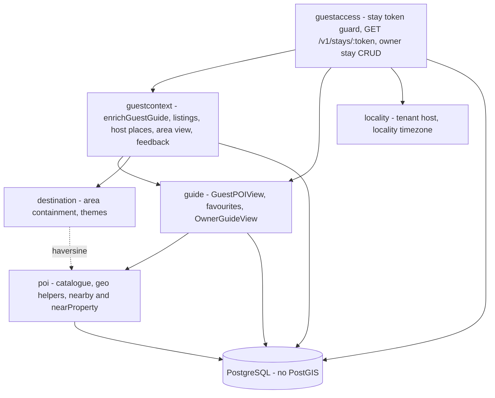
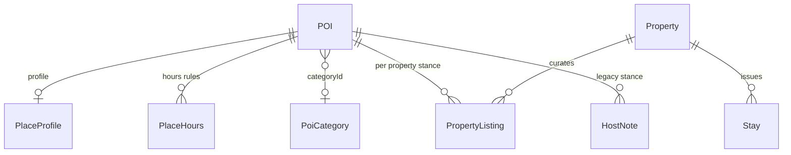
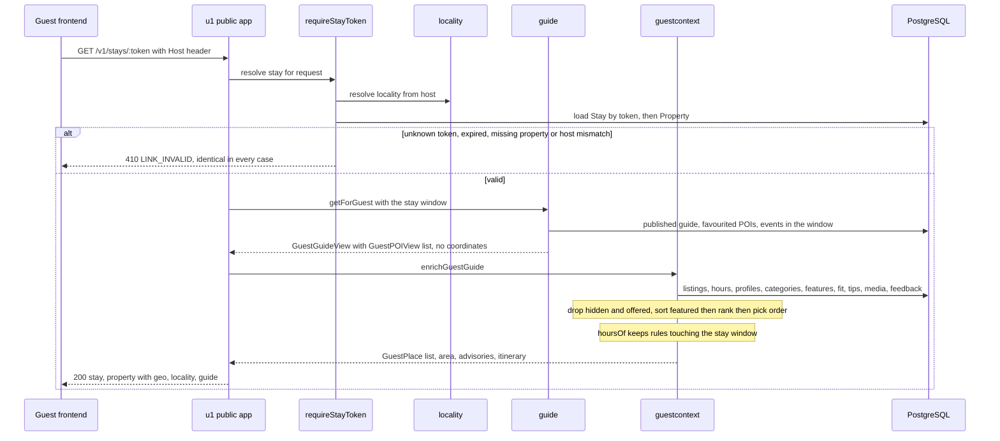
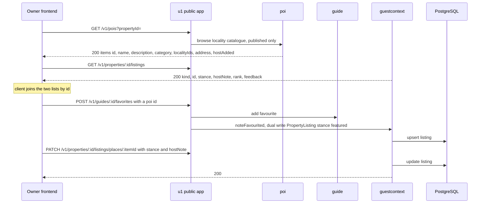
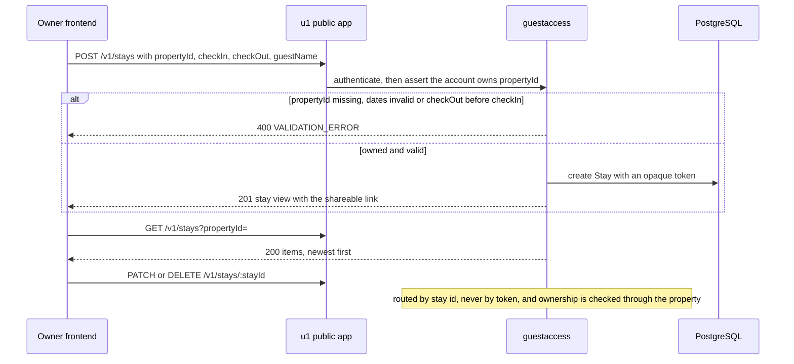
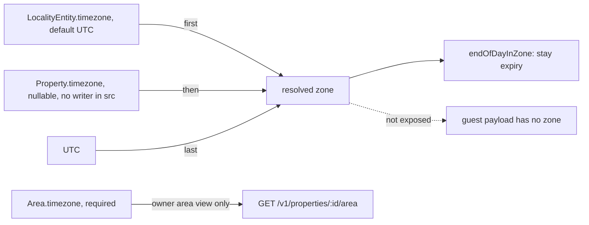
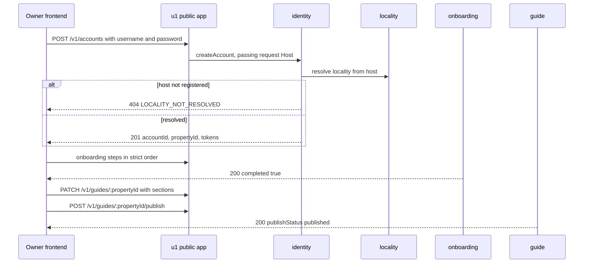
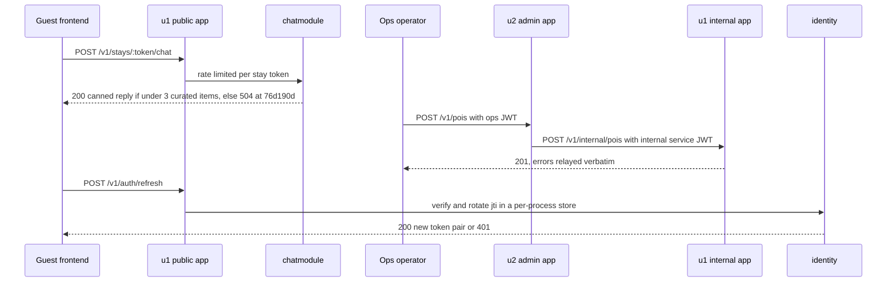

# Architecture — `guestguideiq-app`

**Derived from** two passes:
- The **focused scan of 2026-09-30** at `ce69629` (intent `260927-places-filters`). It deeply analyzed `prisma/schema.prisma`, `src/poi/`, `src/guide/`, `src/guestcontext/`, `src/destination/`, `src/locality/` and `src/guestaccess/`.
- The **prior full scan** at `76d190d` (2026-09-07), preserved for everything else.

Sections that rest on the prior scan are marked *(carried forward from `76d190d`, not re-verified)*. Component responsibilities are in `component-inventory.md`, and wire contracts are in `api-documentation.md`.

---

## System Overview *(topology carried forward from `76d190d`; module list updated)*

The system is two independently deployed TypeScript/Fastify HTTP services over one shared PostgreSQL database, plus two separate AWS CDK apps.

- **u1 `backend-api`** (the repo root) owns the data and hosts every domain module. At `76d190d` it ran two Fastify instances in one process: a public listener (`PORT`, default 3000) and an internal listener bound to `127.0.0.1` (`INTERNAL_PORT`, default 3001).
- **u2 `admin-api`** (`admin-api/`) owns no data and delegates into u1's internal API over HTTP. At `ce69629` the developer confirmed at directory level that its `poi/routes.ts` does not write coordinates, hours or price.

**The module list has grown since the prior scan.** A directory listing of `src/` at `ce69629` shows `destination/`, `guestcontext/`, `hostnote/`, `property/` and `jobs/` alongside the ten modules the prior store described. Of the new modules, this store describes only `destination` and `guestcontext`, which were analyzed deeply. `hostnote/`, `property/` and `jobs/` were observed but not analyzed.

## Architectural Style

The style is a **modular monolith with a satellite ops service, built as ports and adapters**. The prior scan found every module to be a strict `repository.ts` → `service.ts` → `routes.ts` triad. At `ce69629` the analyzed modules still follow that shape, with helper files beside the triad:
- `poi/geo.ts` and `poi/propertyCoordinates.ts`
- `guestcontext/poiCategories.ts` and `guestcontext/hostContent.ts`
- `destination/themes.ts`
- `locality/tenantHost.ts`
- `guestaccess/link.ts`

`destination/` has **no `routes.ts`**. It is a service consumed by other modules, not an HTTP surface.

## Places and Curation Architecture (verified at `ce69629`)

This is the area intent `260927-places-filters` changes. Four modules share it.

*Text fallback*:
- `guestaccess` authenticates the guest by stay token and locality. It reads the published guide from `guide`, then asks `guestcontext` to enrich it.
- `guestcontext` turns each `GuestPOIView` into a `GuestPlace`. It adds the stance, host note, hours, features, fit, price profile, tips, media, category, advisories and the guest's own feedback, and adds the area context through `destination`.
- `guide` builds `GuestPOIView` from `poi` rows.
- `poi` owns the catalogue and the pure-TypeScript geo helpers (haversine, bounding box, coordinate validation). `destination` and `event` also call these helpers.
- All data is in plain PostgreSQL. There is no PostGIS, so every distance calculation happens in application code.

### Data model for a place

This is summarised from `prisma/schema.prisma`; line references are in `component-inventory.md` § persistence.

*Text fallback*:
- **POI**
  - Nullable `latitude` and `longitude`, with a paired-or-absent CHECK and a lat/lng index.
  - Legacy free-text `category` and a nullable `categoryId`.
  - `tier`, `placeGroup`, `address`, and a deprecated `isFree`.
- **PlaceProfile** (0..1 per POI)
  - `priceLevel` is a SmallInt with a CHECK of 0–4.
  - Also `setting`, `typicalMinutes` and `effort`.
- **PlaceHours** (0..n per POI)
  - `dayOfWeek` (0 = Sunday), `opens` and `closes` as `HH:MM` strings, `closesNextDay`, `isClosed`, and `validFrom`/`validUntil`.
  - A day can have several spans.
- **PoiCategory**
  - A taxonomy table created outside Prisma, holding `category`, `subcategory`, `slug`, `icon`, `sortOrder` and `imageKey`.
- **PropertyListing**
  - One row per property and place, holding `stance` (`offered | featured | listed | hidden`), `hostNote`, `rank` and `addedBy`.
- **HostNote**
  - The legacy `recommended | not_recommended` stance. It still drives `GuestPOIView.recommended`.
- **Property**
  - Nullable paired `latitude`/`longitude`, plus `geocodeQuality`, `geocodedAt` and a nullable IANA `timezone`.

### Key design facts for the intent

1. **Two stance systems run in parallel.** `PropertyListing.stance` drives `GuestPlace.stance`, visibility and order. The legacy `HostNote` drives `recommended`. The guest place set is still sourced from the **deprecated** `GuideContent.favoritedPOIIds`, then re-filtered and re-sorted by listing stance (`src/guide/service.ts:378`, `src/guestcontext/service.ts:417-422, 531-540`).
2. **The guest payload is fully materialized and unparameterized.** The host's picks are small and are all returned in one `GET /v1/stays/:token`, with no query parameters. Filtering and sorting on the guest side are therefore naturally **client-side** over one payload. The pieces missing for distance, map and open-now are **server-side**: place coordinates, distance and timezone.
3. **Distance machinery exists but is unreachable.**
   - `POIService.nearby` does a two-stage search: a bounding box, then haversine. It sorts before it truncates, allows a radius of up to 200 km, and returns 100 results by default and 500 at most.
   - `nearProperty` returns `located:false` for an unlocated property.
   - Both are tested (`tests/unit/poiPlaces.test.ts`, `tests/integration/places.pg.test.ts`), but **no route calls them**.
4. **Time is zone-dependent but no zone reaches a client.** Three zone fields exist: `LocalityEntity.timezone` (default `"UTC"`), `Property.timezone` (nullable, with no writer in `src/`) and `Area.timezone` (required). Stay expiry uses locality, then property, then UTC through `endOfDayInZone`. The guest payload has no zone; `/v1/localities/current` omits it on purpose; only the owner `GET /v1/properties/:id/area` exposes `area.timezone`.
5. **`hoursOf` filters by the stay window, not by a date.** A rule valid on only part of the stay is still returned, with `seasonal: true`. A per-date evaluation ("open now", "open on day X") is new logic, and today nothing implements it on either side.

## Data Architecture

- There is one PostgreSQL database; Prisma is both the ORM and the migration tool. There is **no PostGIS** (`schema.prisma:433-437`).
- At `ce69629` the architect counted **32 `model` blocks** and **16 migration directories**; the prior "11 entities, one migration" is superseded. Only the place, curation, category, stay and property-geo models were analyzed deeply.
- These migrations matter to this intent:
  - `20260912000000_import_traumeri_guidebook` inserts 19 POIs with no coordinates.
  - `20260918000000_poi_event_location_and_host_notes` adds POI and event location and the `pois_geo_paired` CHECK.
  - `20260920000000_backfill_poi_types`
  - `20260926000000_poi_categories_and_category_media`
- The prior scan found two per-process in-memory stores: refresh tokens and rate-limit buckets. That finding is carried forward but was not re-verified.

## Deployment Topology *(carried forward from `76d190d`, not re-verified)*

- A multi-stage Dockerfile with `node:20-slim`, a non-root user and `runtime` and `migrate` targets.
- The u1 CDK app has `dev`, `staging` and `production` stacks: ECS Fargate behind an ALB, RDS PostgreSQL 16, Secrets Manager and CloudWatch.
- The u2 CDK app deploys its own Fargate service behind a WAF allowlist.
- The HEAD commit subject at `ce69629` ("Migrate on the exact image that ships, and check it") suggests the migration path has changed since. That was not analyzed.
- A second workflow, `.github/workflows/load-locality-content.yml`, was observed by name. It is a manual OIDC-authenticated ECS task that runs `prisma/seedLocalityContent.ts`, and it is the production content loader.

---

## Interaction Diagrams

T2, T6, T7 and T8 were verified at `ce69629`. T1, T3, T4 and T5 are carried forward from `76d190d` and were not re-verified.

### T2: Guest opens a stay link and reads the Places tab (verified at `ce69629`)

*Text fallback*:
1. The guest's request is authenticated by stay token plus the host-derived locality. All four failure modes return one `410`.
2. On success, `guide` reads the published guide and the favourited places. It projects them to `GuestPOIView`, which leaves out coordinates.
3. `guestcontext` enriches each place. It removes `hidden` and `offered` places, sorts `featured` before `listed`, and attaches hours limited to the stay window, the price profile and the category.
4. The response carries the property's own coordinates, but no place coordinates, no distance and no timezone.

### T6: Host curates a place (verified at `ce69629`)

*Text fallback*:
1. The host loads the locality catalogue. It is a thin six-field projection plus `hostAdded`, with no coordinates, `categoryId`, hours, price or stance.
2. The host loads the listings separately and joins them to the catalogue by id on the client.
3. Picking a place writes the legacy favourite. The route handler then separately calls `guestcontext` through an optional port, which writes a `PropertyListing` with stance `featured`.
4. Stance and host note are then edited per place.

### T7: Host issues a guest stay link (verified at `ce69629`)

*Text fallback*:
1. The owner creates a stay for an explicitly named property they own. `propertyId` is required because an account can own several properties.
2. The server returns the link. The owner can list stays per property, and correct or revoke a stay by its id.
3. The guest's token never appears in owner URLs.

### T8: Resolving "today" for a stay (verified at `ce69629`)

*Text fallback*:
- The server resolves a zone for stay expiry: the locality's zone first, then the property's, then UTC.
- That zone is never sent to the guest.
- The only zone any client receives is `area.timezone`, on the owner's area view.
- An "open now" filter therefore needs one of three things: a zone, or a server-computed flag, added to the guest payload; or a device-clock fallback, which is wrong for a guest planning from another zone.

### T1: Owner signup through first published guide *(carried forward from `76d190d`, not re-verified)*

*Text fallback*: at `76d190d`, signup resolved the tenant from `Host`. The owner then walked the ordered onboarding steps, replaced the guide sections wholesale and published. Later changes were not re-verified; in particular, multi-property accounts and property details may have altered this flow.

### T3: Guest chat, T4: Ops creates a POI, T5: Token refresh *(carried forward from `76d190d`, not re-verified)*

*Text fallback*: these are the three flows the prior scan traced. At `76d190d`:
- Chat always hit a null provider, so it succeeded only through the sparse fallback.
- Ops POI creation went u2, then u1's loopback internal API. Per the focused scan, the u2 POI route carries no coordinates, hours or price.
- Refresh-token rotation was enforced per process only.

---

## Cross-Cutting Constraints a Frontend Must Design Around

1. **Places filters need backend changes before frontend work** (verified at `ce69629`). This is a new constraint.
   - Distance, map and open-now depend on server-side additions: place `latitude`/`longitude` and/or `distanceMeters` in `GuestPlace`, and a resolved zone or a server-computed `openNow` in the stay payload.
   - Price and host-pick filters can be built client-side over the existing payload. They still need the price-scale decision and the stance-field decision (TD-22, TD-23).
   - This is one more backend follow-up. Recorded practice asks for the running total, not a single item: the frontend intent's backend follow-ups already grew three times.
2. **Production content cannot feed the new filters yet** (verified from repository sources; the live database was not queried).
   - None of the 24 repository-defined Sedona places has coordinates.
   - Nothing in the product writes hours or price.
   - Host-added places cannot carry coordinates.
   - Requirements must define the "unknown" state for each filter and decide whether a producer is in scope: ingest, geocoding or host entry.
3. **Host-header tenancy** *(carried forward from `76d190d`, not re-verified)*. Signup and the guest guard resolve the tenant from `Host`. The prior scan found a shared API origin could not serve several locality brands (BR9.2), and named a same-origin proxy as the leading fix. The developer skimmed `src/locality/tenantHost.ts` inside an analyzed path, but did not report on whether this constraint has changed.
4. **CORS and credentials** *(carried forward from `76d190d`, not re-verified)*. At `76d190d` production allowed only the marketing origin and `credentials` was off. The team's affirmed backend follow-up required fixing this before frontend construction, and it may since have landed.
5. **No map key or CSP in the backend** (skimmed at `ce69629`). `src/config.ts` has only Google OAuth keys, and `src/app.ts` sets no CSP. A Google Maps key and its CSP belong to the frontend host. Map rendering must keep the per-place `attribution` that OSM-sourced rows carry, which `GuestPOIView` already exposes.

## Key Design Decisions Worth Preserving

- **Honest absence.** Null means "not stated" throughout the guest types. Filters must add an explicit "unknown" bucket rather than coercing null to closed, free or far.
- **Guest guide as one materialized read.** It gives one round trip, one cacheable response, and client-side filtering over a small set.
- **Uniform `410` for stay-link failures,** so the failure reason never leaks.
- **Owner stay routes keyed by stay id, never by token,** so a live guest credential never enters an owner URL or a server log.
- **Stance hides silently.** The guest never sees an id for a withheld place.
- **A single composition root and ports** *(carried forward)*.

## Improvement Opportunities

- **Retire one stance system.** Choose `PropertyListing.stance`, migrate the `recommended` semantics, and stop sourcing the guest set from the deprecated `favoritedPOIIds`.
- **Route `nearProperty`,** or project coordinates and distance into `GuestPlace`, so the tested geo code is reachable.
- **Resolve and expose a single zone for a stay.** The guest payload should carry it, or the server should compute `openNow` and `openOn(date)`, so hours logic is written once.
- **Add a production write path for coordinates, hours and price:** CSV ingest already supports coordinates, then geocoding with visible quality, then host entry.
- **Fix `browseByLocality`,** whose filter disagrees with its interface comment (TD-26).
- **Carried forward and not re-verified:** a shared Redis for tokens and rate limits, and Fastify JSON schemas on public routes.
