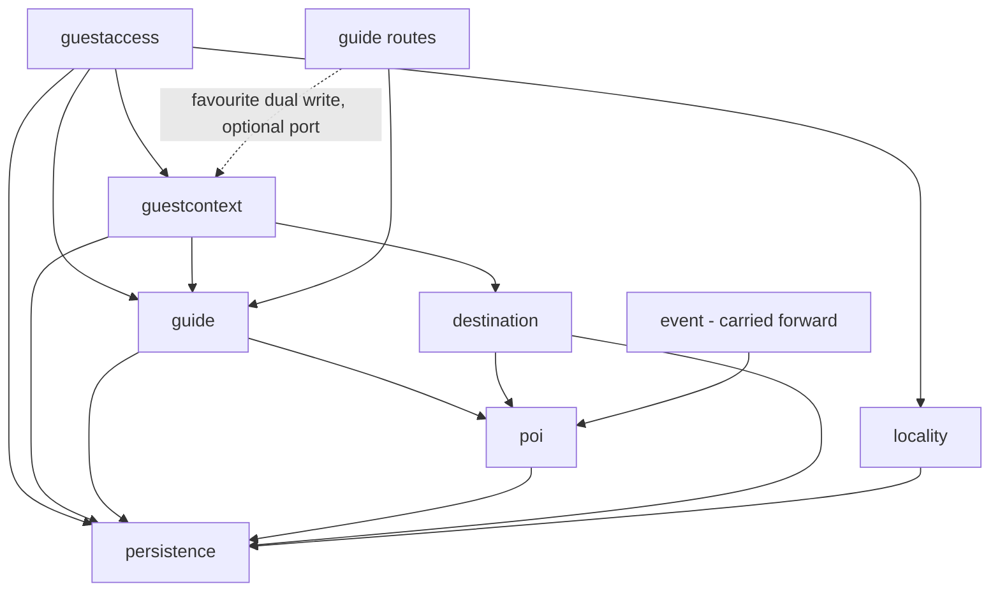

# Component Inventory — `guestguideiq-app`

**Derived from** two passes:
- The **focused scan of 2026-09-30** at `ce69629`. It verified the components `persistence` (schema only), `poi`, `guide`, `guestcontext`, `destination`, `locality` and `guestaccess`.
- The **prior full scan** at `76d190d`, preserved for the rest and marked *(carried forward, not re-verified)*.

The `###` headings below are the canonical component names that the scope block in `reverse-engineering-timestamp.md` uses. Endpoint contracts are in `api-documentation.md`.

**Health ratings:**
- **healthy**: sound and well tested for its purpose.
- **at-risk**: sound code, with a gap that blocks or complicates the current intent.
- **degraded**: known defects.

Components carried forward keep the prior scan's assessment, which may be stale.

---

## Domain components verified at `ce69629`

### poi

**Health**: at-risk. The code is sound and the geo logic is well tested; the problem is its reachability and its data.

**Responsibility**:
- The locality place catalogue.
- The owner-facing catalogue read (`GET /v1/pois?propertyId=`).
- The pure geo helpers in `geo.ts`: `haversineMeters`, `boundingBox` and `isValidLatLng`.
- A two-stage nearby search (`POIService.nearby`) and `nearProperty`, which reads property coordinates through `propertyCoordinates.ts`.

**Depends on**: `persistence`.

**Depended on by**:
- `guide`, which builds `GuestPOIView` from POI rows.
- `destination` and `event`, which use the haversine helpers.
- `chatmodule`, which counts curated items *(carried forward)*.

**Notes**:
- `nearby` and `nearProperty` are **unrouted** (`service.ts:97-99, 178-200, 257-261`).
- The owner projection has six fields plus `hostAdded` (`service.ts:219-227`).
- `browseByLocality` filters by published status, contradicting its interface comment (TD-26).
- The bounding-box antimeridian clamp is a documented limit (`geo.ts:57-59`).
- The catalogue is unpaginated (`repository.ts:166-171`).

### guide

**Health**: at-risk, because it projects without coordinates and still reads the deprecated favourite list.

**Responsibility**:
- The guide aggregate: sections, publish state and favourites.
- The guest projection `GuestPOIView`, through `toGuestPOI` (`service.ts:231-254`), and the owner view.
- The legacy `HostNote`-driven `recommended` and ordering (`service.ts:189-229, 377-406`).
- `stayEvents`: the events during the guest's stay window.

**Depends on**: `poi`, `event` *(carried forward)*, `persistence` and `hostnote` (the legacy stance; not analyzed). The service does not import `guestcontext`. It is the **route layer** (`guide/routes.ts:65-96`) that calls an optional `listings` port (`noteFavourited` and `noteUnfavourited`) to dual-write the `PropertyListing` row.

**Depended on by**: `guestaccess` (the guest read) and `onboarding` (seeding; carried forward).

**Notes**:
- **`toGuestPOI` drops `latitude` and `longitude`.**
- The guest set is sourced from the deprecated `GuideContent.favoritedPOIIds` (`service.ts:378`).
- The guest id arrays list only what resolved; the owner view keeps the full set.

### guestcontext

**Health**: at-risk. It is rich and well tested, but it runs two stance systems side by side, and its hours logic is scoped to the stay window rather than to a date.

**Responsibility**:
- Enriching the guest guide (`enrichGuestGuide`, `service.ts:408`) into `GuestPlace`, `GuestEvent`, area, advisories and itinerary.
- Owner curation: `PropertyListing` stance, host note and rank; host-added places; per-place feedback counts; the owner area view (the only client-visible timezone).
- Guest feedback.
- Category resolution (`poiCategories.ts:194-247`).
- The host-place vocabulary (`hostContent.ts:28-37`).

**Depends on**: `guide`, `destination` (area and themes), `persistence`.

**Depended on by**: `guestaccess` (enrichment on the guest read) and the `guide` **routes** (the favourite dual-write through an optional `listings` port).

**Notes**:
- `hoursOf` (`service.ts:505-529`) filters rules by the stay window.
- Stance filtering and sorting are at `:417-422, 531-540`.
- Host-added places probably resolve to the "Other" category (an untested inference).
- The `locality_category_counts` materialized view counts legacy text and is unmodelled, so it is not usable for per-property counts.

### destination

**Health**: healthy (service only).

**Responsibility**:
- Area resolution, meaning which `Area` a property falls in, by haversine containment (`service.ts:303-319`).
- Themes and audiences (`themes.ts`).
- It supplies `guestcontext`'s area view, which carries the Area's required `timezone`.

**Depends on**: `poi` (the geo helpers), `persistence`.

**Depended on by**: `guestcontext`.

**Notes**: it has **no `routes.ts`**. It is reached only through `guestcontext`.

### locality

**Health**: healthy for this intent.

**Responsibility**:
- Locality brands.
- Host-to-tenant resolution (`tenantHost.ts`, `domainCache.ts`).
- The public `GET /v1/localities/current`, which **deliberately omits `timezone`** (`routes.ts:29-31`).
- The `visualStyling` branding blob.
- `LocalityEntity.timezone`, which defaults to `"UTC"`.

**Depends on**: `persistence`.

**Depended on by**: `guestaccess` (the stay guard, and the first step of timezone resolution) and `identity` *(carried forward)*.

**Notes**: the prior scan named locality as the origin of the Host-header tenancy constraint. The focused scan did not report on whether that has changed.

### guestaccess

**Health**: healthy. The prior scan's blocking gap is closed.

**Responsibility**:
- The stay-token guard (`requireStayToken`, BR8.1–BR8.3), with a uniform `410`.
- The guest read `GET /v1/stays/:token`.
- **The owner stay supply side**: `POST`, `GET`, `PATCH` and `DELETE /v1/stays`, keyed by stay id and ownership-checked through the property.
- Link building (`link.ts`).
- Stay expiry in the resolved zone: locality, then property, then UTC (`repository.ts:130`, through `endOfDayInZone`).

**Depends on**: `locality`, `guide`, `guestcontext`, `property/ownership` (not analyzed), `auth` *(carried forward)*, `persistence`.

**Depended on by**: `chatmodule` *(carried forward)*.

**Notes**: **this supersedes the prior scan's dead-code finding.** `createStay` is now wired to `POST /v1/stays` (`routes.ts:53`). The guest payload carries no timezone and no `expiresAt`; the latter is deliberate.

### persistence

**Health**: at-risk for this intent. The schema supports the filters, but the production content does not populate them.

**Scope of this verification**: `prisma/schema.prisma` was analyzed deeply. Migrations were skimmed. Adapter bodies were covered only within the analyzed modules.

**Responsibility**: the relational model in PostgreSQL, which has **no PostGIS** (`schema.prisma:433-437`). There were 32 models at `ce69629` (a count only). These are the models relevant to the intent:

| Model | Key fields | Lines |
|---|---|---|
| `POI` | `latitude`/`longitude Float?`, WGS84, `pois_geo_paired` CHECK plus range CHECKs, `@@index([latitude, longitude])`; legacy `category`; `categoryId`; `tier`; `placeGroup`; deprecated `isFree` | `:426-439, 524-529, 557` |
| `PoiCategory` | `category`, `subcategory`, `slug`, `icon`, `sortOrder`, `imageKey`. The table was created outside Prisma. | `:546-551, 566-600` |
| `PlaceHours` | `dayOfWeek` (0 = Sunday), `opens`/`closes` `HH:MM` (no format CHECK), `closesNextDay`, `isClosed`, `validFrom`/`validUntil`; several spans per day. No row means unknown. | `:971-990` |
| `PlaceProfile` | One per POI. `priceLevel SmallInt?`, CHECK 0–4 (0 = free). No row or NULL means unknown. | `:1086-1101` |
| `PropertyListing` | `stance` (`offered \| featured \| listed \| hidden`), `hostNote`, `rank`, `addedBy` | `:787-792, 939-963` |
| `Property` | `latitude`/`longitude Float?` (paired), `geocodeQuality`, `geocodedAt`, `timezone` (nullable IANA, with no writer in `src/`) | `:163-166, 230-240` |
| `Area` | `timezone` (required) | `:1118` |
| `LocalityEntity` | `timezone`, default `"UTC"` | `:1505` |
| `GuideContent` | `favoritedPOIIds`, **deprecated** but still the guest place source | `:333-334` |

**Depends on**: `@prisma/client`.

**Depended on by**: every domain component, through ports.

**Notes**:
- No production path writes `POI` coordinates, `PlaceHours` or `PlaceProfile`. See TD-20 and TD-21.
- The `locality_category_counts` materialized view is unmodelled (`:578-581`).

---

## Modules observed at `ce69629` but not analyzed

The architect saw `hostnote/` (the legacy `HostNote` repository), `property/` (`ownership.ts`, `routes.ts`, `service.ts`) and `jobs/` (`expireEvents.ts`) in a directory listing. They were not analyzed, so they have no heading here. Promote them to components in a later scan.

---

## Components carried forward from `76d190d` (not re-verified)

### identity

Account lifecycle and owner authentication: signup, login, password reset and token rotation. At `76d190d`, reset tokens were discarded.

### onboarding

The property-setup state machine. At `ce69629` the developer skimmed `propertyDetails.ts`, which writes the property's paired `latitude`/`longitude` (`:148-195`). This is the only product write path for any coordinate.

### event

Curated local events. At `ce69629` it is known to use the `poi/geo.ts` helpers (`event/service.ts:322-330`).

### subscription

The single-tier Stripe-backed subscription. At `76d190d`, PATCH cancelled on any unrecognised action.

### chatmodule

Guest itinerary chat. At `76d190d` it used a null provider and succeeded only through the sparse fallback.

### leadcapture

Three unauthenticated marketing intake endpoints.

### admin-api

The u2 ops back office, a pure HTTP delegation into u1's internal API. At `ce69629` it was skimmed only: its POI route does not write coordinates, hours or price.

### app-runtime

The two Fastify instances, CORS, the rate-limit `preHandler`, the error envelope, config and wiring. At `ce69629` `src/config.ts` was skimmed: it has only Google OAuth keys and no map key. `src/app.ts` has no CSP or helmet.

### auth

JWT signing and verification, `authenticate`, `requireStayToken`, and the per-process refresh-token store (at `76d190d`).

### ratelimit

Token-bucket limits, per process (at `76d190d`).

### infra-u1

The u1 CDK app (`dev`, `staging`, `production`).

### infra-u2

The u2 CDK app. At `76d190d` it was not deployable because of missing SSM parameters.

---

## Dependency graph for the analyzed area (verified at `ce69629`)

*Text fallback*:
- `guestaccess` depends on `guestcontext`, `guide` and `locality`.
- `guestcontext` depends on `guide` and `destination`.
- `guide` depends on `poi`.
- `guide`'s route layer, not its service, also calls `guestcontext` through an optional port for the favourite-to-listing dual write. The service graph therefore stays acyclic, and the coupling lives at the HTTP edge.
- `destination` and `event` reuse `poi`'s geo helpers.
- Every module reaches `persistence` through its own port.

The whole-system graph from the prior scan (`app-runtime` constructing every component, and `admin-api` coupled only over HTTP) is carried forward and was not re-verified.
