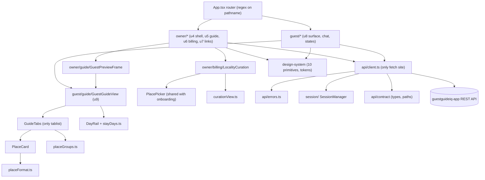
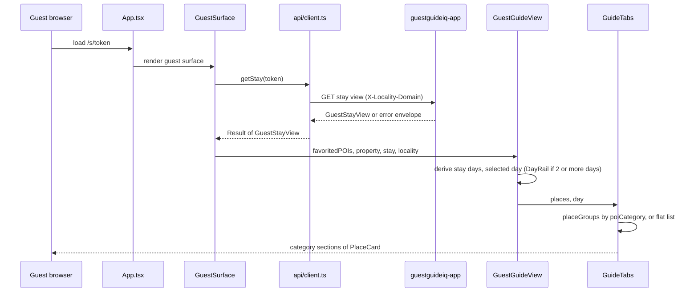
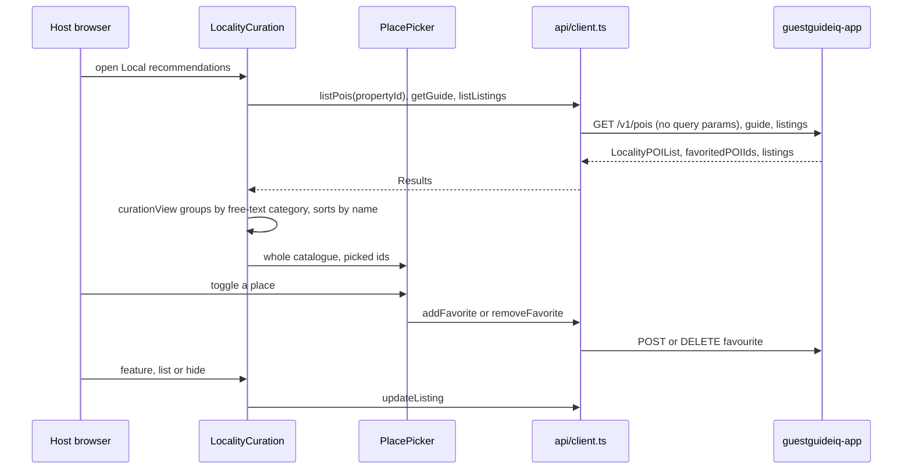
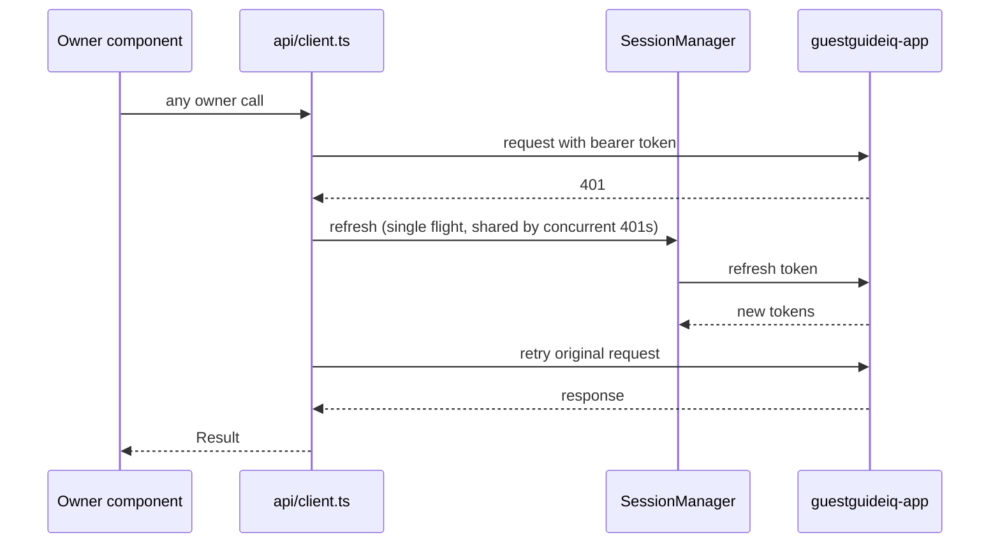

# Architecture — `guestguideiq-frontend`

## Architecture Analysis

### System Overview

A single-page application (React 19, TypeScript, Vite 7) built into a static bundle. It is served from an S3 site bucket behind a CloudFront distribution with a strict response-headers policy, one stack per environment (`infra/lib/frontend-stack.ts`). The SPA calls the separate `guestguideiq-app` REST API cross-origin with bearer tokens. A second S3 bucket holds media.

Two surfaces share one bundle and one routing function:

- **Owner app**: every path except `/s/<token>`.
- **Guest guide**: `/s/<token>`.

Routing is a regex over `window.location.pathname` in `src/App.tsx`. `react-router-dom` is declared but not imported.

### Architectural Style

A layered modular monolith on the client, organised by the unit decomposition of intent `260907-frontend-app` (u1 to u9). Imports flow downward only:

```
UI (owner/*, guest/*)  ->  view state / pure view modules  ->  api/client.ts  ->  fetch
                                  |                              |
                           design-system (u2)            api/contract (u1, types)
```

Evidence:
- ESLint `no-restricted-globals` bans `fetch`, `localStorage` and `sessionStorage` outside `src/api/**` and `src/session/**`.
- Raw-HTML sinks are banned by lint.
- Every client method returns `Result<T>` and never throws.
- `errors.ts` is the only module that reads an HTTP status.

### Component Relationships



Text fallback: `App.tsx` dispatches to the owner tree or the guest tree. The guest tree renders `GuestGuideView`. The owner tree renders the same `GuestGuideView` inside `GuestPreviewFrame`, and renders `LocalityCuration`, which uses `PlacePicker` and `curationView`. `GuestGuideView` owns the selected-day state from `DayRail`/`stayDays`, and passes it to `GuideTabs`. `GuideTabs` groups places with `placeGroups` and renders `PlaceCard`, which formats hours and price with `placeFormat`. Both trees call the backend only through `api/client.ts`, which uses `errors.ts`, the session manager and the contract types.

### Interaction Diagrams

**1. Guest opens a stay link and views the Places tab**



Text fallback: the guest loads `/s/<token>`. The router renders the guest surface, which calls `getStay(token)` once. The client sends the request with the tenant header and returns a `Result`. On success, `GuestGuideView` receives the host-picked places (already ordered by the server), works out the stay days and the selected day, and passes both to `GuideTabs`. `GuideTabs` groups places by `poiCategory` (or falls back to a flat list) and renders one `PlaceCard` per place. The selected day is passed down but does not filter places today (`GuideTabs.tsx:377-382`).

**2. Host curates local recommendations**



Text fallback: the curation panel loads the whole locality catalogue, the guide's picked IDs and the listing stances, then joins them client-side. `curationView` groups by the legacy free-text `category` and sorts by name, which is different from the guest `placeGroups`. Toggling a place calls `addFavorite`/`removeFavorite`, and stance changes call `updateListing`. `PlacePicker` has a known, bounded out-of-order toggle race (`PlacePicker.tsx:19-32`).

**3. Authenticated owner request with an expired token**



Text fallback: concurrent 401s collapse into one in-flight refresh, and every waiter retries against its result (team.md, Code Style). Requests lost to an expired session are held in a replay registry (`api/replay.ts`, header only read).

### Data Flow

- **Read path**: backend JSON -> `client.ts` (typed by `api/contract`) -> `Result<T>` -> surface component -> pure view modules (`placeGroups`, `placeFormat`, `stayDays`, `curationView`) -> presentational components.
- **Write path** (owner only): component -> client method -> `Result<T>`. No optimistic cache layer was observed; components hold state locally.
- **Theming**: locality brand -> typed design tokens as CSS custom properties on a root element (u3 `LocalityBrandResolver`), never injected style tags. This is what keeps `style-src 'self'` possible.

### Security posture (intent-relevant)

Deployed headers (`infra/lib/frontend-stack.ts:263-298`):

- CSP: `default-src 'self'`, `script-src 'self'`, `connect-src 'self' <api origin>`, `img-src 'self' data:`, `style-src 'self'`, `font-src 'self'`, `object-src 'none'`, `frame-ancestors 'none'`. There is no nonce, because static hosting cannot mint one; `modulePreload.polyfill: false` keeps inline scripts out of the build.
- `Referrer-Policy: no-referrer` globally, because the guest URL carries a live credential.
- `Permissions-Policy: geolocation=()`.

Consequences for embedding Google Maps:

1. The Maps JS API cannot load under this CSP. It needs Google origins in `script-src`, `connect-src`, `img-src` and `font-src`, and by Google's published guidance probably inline styles and `worker-src blob:` as well. Confirm the list against current Google documentation. Loosening `script-src` or `style-src` weakens the XSS defence that protects the 7-day non-revocable token, so this is a security decision for design.
2. A Maps key restricted by HTTP referrer depends on the Referer header, which `no-referrer` suppresses. The guest route `/s/<token>` must not leak to Google either way.
3. A `VITE_*` Maps key is compiled into `dist/` and is expected to trip the blocking `scan-built-output` gitleaks job. It needs a documented allowlist entry (owner, reason, expiry) under `SECURITY.md`, not a weaker gate.

### Key Design Decisions (observed)

| Decision | Evidence | Implication |
|---|---|---|
| One API client, `Result<T>`, never throws | `client.ts`, ESLint globals ban | Contract additions such as coordinates or timezone land in `api/contract` + `client.ts` only |
| Hand-written contract with pinned provenance digests | `api/contract/PROVENANCE.md` | Every contract change also updates `PROVENANCE.md`; no generated client (ADR-006 open) |
| One shared guide renderer for guest and owner preview | `GuestPreviewFrame.tsx:72-78`, `GuestGuideView.tsx:17-20` | New Places UI must render sensibly with no places, property or stay |
| Strict static CSP on static hosting | `frontend-stack.ts` | Any third-party script is a CSP and security decision |
| Regex routing, no router library | `App.tsx` | New views are state within a surface, not routes |
| Selected day lives in `GuestGuideView` | `GuestGuideView.tsx:183`, `DayRail.tsx:532` | No selected day for one-day stays or the preview |

### Improvement Opportunities

- Unify the two place-grouping modules (`placeGroups.ts` versus `curationView.ts`): they differ in category source, "Other" label and within-group ordering.
- Remove the unused `react-router-dom` dependency.
- Make `Dialog` background-inert before building a modal filter sheet on it.
- Restore the staging stack and an enforced production reviewer (see `code-quality-assessment.md`).
