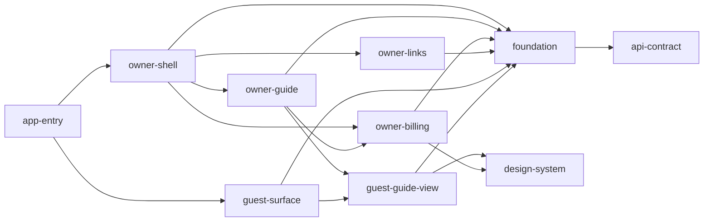

# Component Inventory — `guestguideiq-frontend`

Components follow the unit decomposition of intent `260907-frontend-app`. Headings are the canonical component names used by the Scope of Analysis block in `reverse-engineering-timestamp.md`. Depth of analysis is noted per component.

## Boundary and foundation components

### api-contract

- **Unit**: u1-api-contract. **Path**: `src/api/contract/`.
- **Responsibility**: hand-transcribed backend types (`entities.ts`, `primitives.ts`) and path constants (`paths.ts`); provenance digests (`PROVENANCE.md`).
- **Depends on**: nothing at runtime.
- **Depth**: deep for `entities.ts`, `paths.ts`, `primitives.ts`, `index.ts`; `PROVENANCE.md` first 80 lines.

### foundation

- **Unit**: u3-foundation. **Paths**: `src/api/client.ts`, `src/api/errors.ts`, `src/api/replay.ts`, `src/session/`, `src/theme/`, `src/foundation.ts`.
- **Responsibility**: the only `fetch` site; the error-envelope parser; session, token store and single-flight refresh; locality brand to design tokens.
- **Depends on**: api-contract.
- **Depth**: deep for the `ApiClient` interface, `send`, `errors.ts`, `foundation.ts`; `replay.ts`, `session/` and `theme/` skimmed.

### design-system

- **Unit**: u2-design-system. **Path**: `src/design-system/`.
- **Responsibility**: 10 generic primitives (including `Dialog`, a focus trap that is not background-inert, and `TabBar`) and the token contract (`tokens.ts`, `tokens.css`).
- **Depends on**: nothing internal.
- **Gaps for this intent**: no chip, sheet, disclosure, checkbox-group or radio-group primitive.
- **Depth**: index and tokens deep; primitives headers only.

## Application components

### app-entry

- **Paths**: `src/main.tsx`, `src/App.tsx`, `index.html`, `src/vite-env.d.ts`.
- **Responsibility**: bootstrap and pathname-regex routing between owner and guest surfaces.
- **Depends on**: owner-shell, guest-surface, foundation.
- **Depth**: deep.

### owner-shell

- **Unit**: u4. **Paths**: `src/owner/OwnerApp.tsx`, `src/owner/shell/`.
- **Responsibility**: owner shell, auth screens and navigation.
- **Depends on**: foundation, design-system.
- **Depth**: skimmed.

### owner-guide

- **Unit**: u5. **Path**: `src/owner/guide/`.
- **Responsibility**: guide editor, onboarding flow (reuses `PlacePicker`) and `GuestPreviewFrame`, which renders guest-guide-view with no places, property or stay.
- **Depends on**: guest-guide-view, owner-billing (`PlacePicker`), foundation, design-system.
- **Depth**: `GuestPreviewFrame.tsx` deep; rest skimmed.

### owner-billing

- **Unit**: u6. **Path**: `src/owner/billing/`.
- **Responsibility**: plan controls and Local recommendations: `LocalityCuration`, `PlacePicker`, `curationView`, `HostPlaceActions`, `AreaPanel`, `ListingControls`, host places and tips, `CancelConfirmDialog`, `ServerEmptyState`.
- **Intent-relevant facts**: lists the whole locality catalogue; groups by free-text `category` with names sorted; no hours, price, `poiCategory` or coordinates on catalogue rows; known bounded toggle race in `PlacePicker.tsx:19-32`.
- **Depends on**: foundation, design-system.
- **Depth**: curation modules deep; `ListingControls.tsx` first 80 lines; `HostPlaceForm`, `HostTips`, `PlanControls`, `CancelConfirmDialog`, `ServerEmptyState` skimmed.

### owner-links

- **Unit**: u7. **Path**: `src/owner/links/`.
- **Responsibility**: guest links (stays).
- **Depends on**: foundation, design-system.
- **Depth**: skimmed.

### guest-surface

- **Unit**: u8. **Paths**: `src/guest/GuestSurface.tsx`, `ChatWidget.tsx`, `AskPrompt.tsx`, `states.tsx`, `guest.css`.
- **Responsibility**: loads the stay with `getStay(token)`, renders loading, error and invalid-link states, and hosts the chat widget.
- **Depends on**: guest-guide-view, foundation, design-system.
- **Depth**: skimmed (wiring lines and class names).

### guest-guide-view

- **Unit**: u9-guest-guide-view. **Path**: `src/guest/guide/`.
- **Responsibility**: the one guide renderer, shared by guest and owner preview.
  - `GuestGuideView`: composition; owns selected-day state; no preview-mode prop allowed.
  - `GuideTabs`: Overview / Places / Events; the only tablist; category sections with `h3` headers and counts (not collapsible) (`GuideTabs.tsx:434-463`); places not filtered by day (`:377-382`).
  - `PlaceCard`: one place; "Recommended by your host" for `hostAdded`; no "Host pick" label.
  - `placeGroups`, `placeFormat`, `stayDays`, `DayRail` (radiogroup, roving tabindex, 2 or more days only).
  - Also: `Essentials`, `EventRow`, `DuskHeader`, `AdvisoryBanner`, `AreaKnownFor`, `ItineraryPanel`, `FeedbackButtons`, `IdentityBlock`, `icons`.
- **Depends on**: foundation (types and feedback call), design-system.
- **Depth**: Places modules deep; other components skimmed.

## Test and tooling components

### mocks

- **Path**: `src/mocks/` (`backend.ts` 346 lines, `handlers.ts` 2,050 lines).
- **Responsibility**: stateful MSW backend double used by scenario tests.
- **Depth**: headers, state types, route table and `guestPlace` construction only.

### dev-showcase

- **Path**: `src/dev/`. **Responsibility**: design-system showcase, dev only. **Depth**: skimmed.

## Delivery components

### infra

- **Path**: `infra/` (separate CDK package).
- **Responsibility**: per environment, one S3 site bucket, one S3 media bucket, one CloudFront distribution with an SPA function and a response-headers policy (CSP, `no-referrer`, frame DENY, `Permissions-Policy: geolocation=()`).
- **Depth**: `frontend-stack.ts` props, SPA function, media bucket and headers deep; `bin/frontend.ts` and the rest skimmed.

### ci-cd

- **Paths**: `.github/workflows/ci.yml`, `.github/workflows/deploy.yml`, `scripts/post-deploy-check.mjs`.
- **Responsibility**: verify, infra, scan and scan-built-output jobs; OIDC deploy with rollback snapshot and Playwright post-deploy check.
- **Depth**: `ci.yml` deep; `deploy.yml` gating sections; post-deploy script header.

## Component dependency graph

Text fallback: `app-entry` routes to `owner-shell` or `guest-surface`. The owner shell hosts `owner-guide`, `owner-billing` and `owner-links`. Both `owner-guide` (preview) and `guest-surface` render `guest-guide-view`. `owner-guide` reuses `PlacePicker` from `owner-billing`. Every application component reaches the backend only through `foundation`, which depends on `api-contract`. UI components use `design-system`.
