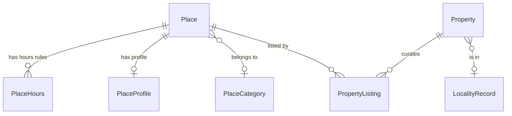

# Functional Specification: u1-places-api

Upstream: the unit definition (`../../../inception/units-generation/unit-of-work.md`, U1), its requirement map (`../../../inception/units-generation/unit-of-work-story-map.md`), the requirements (`../../../inception/requirements-analysis/requirements.md`, FR2.2, FR10.1–FR10.5, NFR4, NFR6) and the component catalogue (`../../../inception/domain-design/components.md`). Answers from `functional-design-questions.md` are cited as FQ1–FQ3. There is no contract-summary document, because contract design was skipped. Section 2 of this document takes its place.

Entities are in `entities.md` and rules in `rules.md`. This document is the source of truth for the workflows and for the agreed response shapes.

## 1. Scope

This unit makes three additive changes to the backend (`guestguideiq-app`):

1. Each place in the guest stay response carries its distance from the property.
2. The guest stay response and the host place list carry the property's timezone.
3. Each row of the host place list carries its shared category, hours, price level, distance and stance.

Nothing is stored, no table changes, and no address is added. There is no state machine: none of the entities this unit touches changes state because of it.

## 2. Agreed Response Shapes (the contract between u1 and u2)

This section is the single owner of the shapes. `u1-places-api` implements them. `u2-places-foundation` transcribes them into the frontend's types, client and mocks, and records this file in its contract provenance. A change to either side starts here.

### 2.1 Guest stay response (existing address, guest read by stay link)

| Field | Type | Meaning | Rule |
|---|---|---|---|
| `property.timezone` | text or null | IANA Region/City zone name of the property. Null when no real zone is configured | BR2.1, BR2.2 |
| `guide.favoritedPOIs[].distanceMeters` | whole number or null | Straight-line distance from the property, in metres. Null when unknown | BR1.1–BR1.3 |

Unchanged and relied on by the frontend: each place's `poiCategory`, `hours`, `profile.priceLevel` (0–4, 0 is free), `stance`, and `property.geo`.

### 2.2 Host place list (existing address, owner-authenticated, by property)

| Field | Type | Meaning | Rule |
|---|---|---|---|
| `timezone` (top level) | text or null | Same meaning as `property.timezone` above | BR2.1, BR2.2 |
| `items[].poiCategory` | object or null | Shared category: `id`, `category`, `subcategory`, `slug`, `icon`, `sortOrder`, `imageUrl`. Same shape as on a guest place | BR3.1 |
| `items[].hours` | object or null | Same shape as a guest place's `hours`: `days[]` of `dayOfWeek`, `closed`, `spans[]` of `opens`, `closes`, `closesNextDay`; plus `seasonal`. Rules in effect today | BR3.1, BR3.4 |
| `items[].priceLevel` | whole number 0–4 or null | 0 is free | BR3.1, BR5.1 |
| `items[].distanceMeters` | whole number or null | As for guests | BR1.1–BR1.3 |
| `items[].stance` | `offered`, `featured`, `listed`, `hidden` or null | This property's stance. Null when the property has no listing for the place | BR3.1, BR3.3 |

Existing row fields are unchanged: `id`, `name`, `description`, `category`, `localityIds`, `address`, `hostAdded`. The existing empty-locality response is unchanged and gains only `timezone`.

### 2.3 Rules that apply to every added field

- Optional and nullable. Absent and null mean the same thing to a client: unknown (BR4.1).
- Unknown is never sent as 0, an empty string or UTC (BR1.2, BR2.2).
- No place coordinate appears anywhere (BR1.4).

## 3. Workflows

### W1. Guest opens a stay link (changed)

1. The stay link is checked and the stay, property and locality are resolved, as today.
2. The guide's places are loaded and filtered to the stances a guest may see, as today (BR3.3).
3. **New:** the property's location is looked up once. For the visible places, each place's distance from the property is computed (BR1.1–BR1.3). If the property has no location, every distance is null (BR1.2).
4. **New:** the property's timezone is resolved by the shared helper from the locality's zone and the property's zone (BR2.1, BR2.2).
5. The response is sent with `distanceMeters` on each place and `property.timezone`.

Error paths:
- An invalid or expired link returns the existing uniform refusal. Nothing new is revealed.
- A failure while looking up the property's location or computing distance must not fail the guest read. The response is sent with every distance null, and the failure is logged. Distance is an enhancement; the guide is the product.

### W2. Host loads the place list for a property (changed)

1. The owner is authenticated and their ownership of the property is checked, as today (BR3.2).
2. The locality's catalogue rows are loaded, as today.
3. **New:** the route asks the guest context code to enrich the rows for this property (FQ3). In one pass it gathers, for the listed places: shared category, hours rules in effect today (BR3.4), price level, this property's stance, and the distance from the property.
4. **New:** the property's timezone is resolved by the same shared helper (BR2.1, BR2.2).
5. The response is sent with the enriched rows and `timezone`.

Error paths:
- An unauthenticated caller or a property the caller does not own gets the existing refusal (BR3.2).
- A place with no enrichment data is still returned, with the new fields null (BR3.5).
- When the optional enrichment connection is not wired in, the previous shape is returned (BR4.2).
- A failure inside enrichment fails the request with the existing server-error envelope. Unlike W1, a host panel showing a half-enriched list would mislead the host about stance.

### W3. Stay expiry (behaviour preserved)

1. When a stay is created or its dates change, expiry is the end of the check-out day in the property's zone.
2. The zone comes from the same shared helper. When it finds no real zone, expiry uses UTC, exactly as today (BR2.3).

One edge changes. Today a locality whose zone is the UTC default hides a property's own zone. With the helper, the property's own zone is used in that case. No product path sets a property's own zone today, so no existing stay is affected. A test pins the new behaviour.

## 4. Where the Code Changes

This is design-level placement, checked against commit `ce69629`. It is not an implementation plan.

| Concern | Placement | Note |
|---|---|---|
| Distance for a property's places | Place catalogue code, next to the existing distance helpers and the property-location lookup | Takes the property and a set of place ids. Reads place coordinates itself, so they never leave this code (BR1.4) |
| Timezone helper | A small shared function beside the existing end-of-day helper | Replaces the one-line rule in the guest access data layer. The locality code is not changed (FQ1) |
| Guest enrichment | Guest context code, where places are already enriched | Adds distance to each visible place |
| Host enrichment | Guest context code, called by the existing place-list route through an optional connection | The route stays where it is (FQ3) |
| Contract note | The backend's hand-kept contract document | Records section 2 and the price scale (BR5.1) |

### Decision record: ADR-007, timezone rule as a shared helper (supersedes ADR-003)

- **Context:** ADR-003 moved timezone resolution into the locality component. Review found that heavier than needed. The rule is one line; the locality component would have had to read a property's zone; and a third, different copy exists in the events code.
- **Decision:** a small shared helper function holds the rule. Guest access (for the guest response and stay expiry) and the guest context code (for the host place list) call it. The locality component is unchanged (FQ1).
- **Consequences:**
  - Positive: no new dependency between components, and one rule for the two responses and stay expiry.
  - Negative: the events code keeps its own line, which has no property zone to consider. It is out of this unit's scope and is listed as follow-up.
- **Alternatives rejected:**
  - ADR-003 as written: adds a property read to the locality component for a one-line rule.
  - Leave the rule in the guest access data layer and copy it: two copies that must agree.

### Disclosed route-level tie

The place-list route in the place catalogue code calls the guest context code, and the guest context code uses the place catalogue. This tie already exists for host-added places. It is bounded to the route layer: no service in the place catalogue code depends on the guest context code. This corrects the "no cycle" statement in the domain design.

## 5. Cost Note

- **Guest read:** distance is computed for one property's visible picks. That is one extra read of the property's location and one of the places' coordinates, then arithmetic.
- **Host list:** distance and enrichment are computed for the whole locality catalogue on every read, because the list is unpaginated. Enrichment must fetch per kind of data (categories, hours, profiles, listings, coordinates) in one query each for the whole list, never one query per row.

## 6. Derived Views

### Entity relationships (derived from `entities.md`)

<!-- Text fallback: A Place has many PlaceHours rules, at most one PlaceProfile, and optionally one PlaceCategory. A Place has many PropertyListings, each belonging to one Property. A Property optionally belongs to one LocalityRecord. -->

### Rules summary (derived from `rules.md`)

| Group | Rules | Subject |
|---|---|---|
| BR1 | BR1.1–BR1.4 | Distance: calculation, unknown as null, whole metres, coordinates never sent |
| BR2 | BR2.1–BR2.3 | Timezone: resolution order, UTC default is unknown, stay expiry fallback |
| BR3 | BR3.1–BR3.5 | Host place list: fields, authorization, stances, hours in effect, missing data |
| BR4 | BR4.1–BR4.2 | Compatibility: optional and nullable, previous shape without enrichment |
| BR5 | BR5.1 | Price scale |

## 7. Scenarios to Write First

Team practice is scenario first. These are the scenarios this unit's tests start from.

| # | Given | When | Then | Rules |
|---|---|---|---|---|
| S1 | A located property and a place 678 metres away | the guest stay is read | the place's `distanceMeters` is 678 and no coordinate appears | BR1.1, BR1.3, BR1.4 |
| S2 | A located property and a place with no location | the guest stay is read | that place's `distanceMeters` is null | BR1.2 |
| S3 | A property with no location | the guest stay is read | every `distanceMeters` is null | BR1.2 |
| S4 | A locality with zone `America/Phoenix` | the guest stay is read | `property.timezone` is `America/Phoenix` | BR2.1 |
| S5 | A locality left at the UTC default and a property with no zone | the guest stay is read | `property.timezone` is null | BR2.2 |
| S6 | A locality left at the UTC default and a property with zone `America/Denver` | the guest stay is read | `property.timezone` is `America/Denver` | BR2.1, BR2.2 |
| S7 | A catalogue of three places, one featured, one hidden and one unlisted | the owner reads the place list | the rows carry stance `featured`, `hidden` and null | BR3.1, BR3.3 |
| S8 | A place with hours, a price level of 0 and a shared category | the owner reads the place list | the row carries `hours`, `priceLevel` 0 and `poiCategory` | BR3.1, BR5.1 |
| S9 | A place with an hours rule that ended last month | the owner reads the place list | the row's `hours` is null | BR3.4 |
| S10 | A caller who does not own the property | the place list is requested | the existing refusal is returned | BR3.2 |
| S11 | A hidden place among the host's picks | the guest stay is read | the hidden place is absent, as today | BR3.3 |
| S12 | The previous frontend's expectations of both responses | both are read | every existing field is present and unchanged | BR4.1 |
| S13 | No real zone for a property | a stay is created | expiry is the end of the check-out day in UTC | BR2.3 |

## 8. Out of Scope and Follow-up

- Filling in coordinates, hours or prices for places, and letting hosts set a property's location.
- Query parameters for filtering, sorting or paging either list.
- The events code's own timezone line.
- The place catalogue's hidden-places inconsistency found in the scan (TD-26).
- Retiring the older "recommended" signal.

## 9. Open Points

- **Production data:** the real counts of places with coordinates, hours and price, and of properties with a location and of localities with a real zone, are still unknown. Until they are filled, these fields will mostly be null in production.
- **Host place list size:** the list is unpaginated and each row grows. Acceptable now; revisit if a locality's catalogue passes a few hundred places.

## Review

**Verdict:** READY
**Reviewer:** aidlc-architecture-reviewer-agent
**Date:** 2026-10-02T05:19:35Z
**Iteration:** 1

### Findings

| ID | Severity | Location | Finding | Required action | Status |
|---|---|---|---|---|---|
| R-01 | Major | aidlc/spaces/default/intents/260927-places-filters/construction/u1-places-api/functional-design/functional-spec.md > W2 steps 3-4 and section 4 "Host enrichment" row | The host path has no named source for the data the enrichment needs. The route holds only `PropertyLocalityLookup.getLocalityBrandId`, which returns a brand id. The locality's zone and the property's own `timezone` are read nowhere on that path (`src/guestcontext/repository.ts` has only the area zone). The shared helper (BR2.1) therefore has no inputs there, and BR3.4 needs the zone to decide "today". W2 also lists enrichment (step 3) before the zone is resolved (step 4), the reverse of the dependency. The route's `items` are projected by `browseByLocality` and drop `categoryId`, which the category resolver needs for an exact category; the spec never says where `categoryId` comes from. | State, for the host path, which code reads the locality zone, the property zone, `categoryId` and the property location. Reorder W2 so the zone is resolved before hours. Say that enrichment runs on the owner-filtered rows, after the existing host-added filter, not on the full catalogue. | New |
| R-02 | Major | aidlc/spaces/default/intents/260927-places-filters/construction/u1-places-api/functional-design/functional-spec.md > W2 error paths | Any failure inside enrichment fails the whole host place-list request, while W1 degrades to null for distance. Enrichment is five whole-catalogue queries. A failure in a field the existing host picker ignores (hours, price, distance) would take down the picker, which is the only curation surface, after u1 deploys ahead of u2. That sits poorly with NFR6 and the "deploy backend first" goal. The stated reason (a half-enriched list would mislead about stance) holds only for stance, not for the other fields. | Either degrade the non-stance fields to null on failure, logged as in W1, and fail only if the stance read fails, or record the all-or-nothing choice as a deliberate decision with its availability cost. Add a rule and scenario either way. | New |
| R-03 | Minor | aidlc/spaces/default/intents/260927-places-filters/construction/u1-places-api/functional-design/entities.md > LocalityRecord.timezone; functional-design-questions.md Q2 | "UTC only ever means never set" is false at commit `ce69629`. `isValidTimeZone` accepts exactly `UTC` (`src/lib/dayBoundary.ts`), and `PATCH /v1/internal/localities/:localityId/timezone` and locality create validate with it, so an operator can set `UTC` explicitly. The design still behaves safely (explicit UTC is sent as null, the open filter hides), but the stated premise is wrong and the behaviour for an explicit UTC locality is not disclosed. The claim "no product path sets a property's own zone" does hold: `src/property` has no timezone write and the column is unvalidated free text. | Reword to "UTC cannot be told apart from never set; an explicit UTC locality is treated as unknown by design", in entities.md and the BR2.2 rationale, and add the case to the W3 edge note. | New |
| R-04 | Minor | aidlc/spaces/default/intents/260927-places-filters/construction/u1-places-api/functional-design/functional-spec.md > section 2.2 `items[].poiCategory`, `items[].hours` | Section 2 is the single contract the frontend transcribes, but it lists names without inner types or nullability. In `src/guestcontext/poiCategories.ts` the category has category-level precision, with `id`, `subcategory` and `slug` null (stated to be every production place today), and `icon` and `imageUrl` nullable. For hours, `opens` and `closes` are text clock values, `dayOfWeek` is 0 for Sunday, and a day with no rule is omitted (unknown, not closed). None of this is in section 2. | Add inner field types, nullability, units and the omitted-day rule to 2.2, or cite the exact existing guest type by name as the shape. | New |
| R-05 | Minor | aidlc/spaces/default/intents/260927-places-filters/construction/u1-places-api/functional-design/rules.md > BR3.4; functional-spec.md section 7 | Several stated behaviours have no rule or scenario. These are: the W1 "distance failure leaves distances null and is logged" path; the W2 failure path; and the BR3.4 boundaries (whether `validUntil` is inclusive, and that the comparison is on date-only values against "today in the property zone", not instants). S9 covers only a rule that ended last month. | Add a rule and scenario for the W1 failure isolation, and boundary scenarios for the first and last valid day. | New |
| R-06 | Minor | aidlc/spaces/default/intents/260927-places-filters/construction/u1-places-api/functional-design/functional-spec.md > W1 step 3 and section 5 | W1 and the cost note describe a separate property-location read. The guest route already has the property's coordinates from `getPropertyWithLocality` (`details.latitude` and `details.longitude`, used for `property.geo`). `enrichGuestGuide` does not receive them today. A second read via `PropertyCoordinatesLookup.getCoordinates`, which throws NotFound for an unknown property, is avoidable. | State that the already-loaded location is passed into the guest enrichment, or justify the second read. | New |
| R-07 | Minor | aidlc/spaces/default/intents/260927-places-filters/construction/u1-places-api/functional-design/functional-spec.md > BR4.2; section 4 disclosed route-level tie | `registerPOIRoutes` already takes an optional `hostContent` parameter typed as `Pick<HostContentService, 'placeOwners'>`. The spec does not say whether the enrichment connection is that same parameter or a second one, so "absent" is ambiguous when only one is wired. It also leaves ADR-003 (`decisions.md`, status Accepted) and the components.md "no cycle" statement uncorrected, with only this spec noting the change. | Name the port and the wiring combinations, and list the inception statements this spec supersedes so downstream readers are not misled. | New |
| R-08 | Minor | aidlc/spaces/default/intents/260927-places-filters/construction/u1-places-api/functional-design/functional-spec.md > section 2.2 `items[].stance` | Stance null means "no listing". `enrichGuestGuide` treats a favourite with no listing as featured, so a place a guest sees as featured can show null in the host list. The frontend unit could misread null as "not shown to guests". | State that null stance does not mean hidden from guests and say how u4 should treat it. | New |

### Validation Tool Results

| Tool | Result | Interpretation |
|---|---|---|
| YAML parse of the `rules.md` and `entities.md` blocks (node `yaml`) | PASS: 15 rules, 11 entities | Both source-of-truth blocks are well-formed |
| Rule and traceability cross-check (manual) | PASS | All 15 BR IDs appear in `traceability.json` coverage or reverse; FR2.2, FR10.1-FR10.5 and NFR6 map to existing rules |
| Source checks at `ce69629` | Mixed | Confirmed: `haversineMeters`, the optional `hostContent` port, the `browseByLocality` projection, the `property.timezone` free-text column, and no property zone write. Contradicted: "UTC only ever means never set" (R-03) |

### Summary

The design is implementable and its rules cover FR2.2, FR10.1-FR10.5 and NFR6. It answers the five carried findings: route owner, timezone helper, fallback meaning, whole-catalogue cost and a single owner of the shapes. It stays additive, leaks no place coordinates and leaves authorization unchanged. Two Major gaps remain for the human to weigh at the gate: the host-path data sources are not named (R-01) and enrichment failure takes down the existing host picker (R-02). The rest are Minor.
