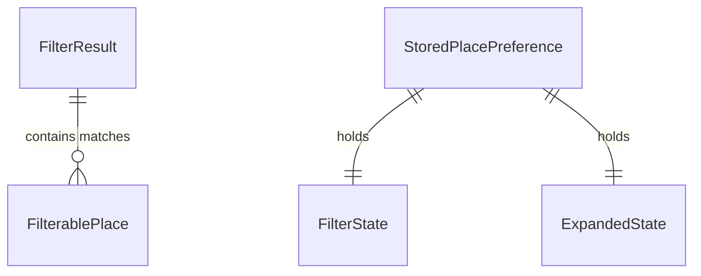

# Functional Specification: u2-places-foundation

Upstream: the unit definition (`../../../inception/units-generation/unit-of-work.md`, U2), its requirement map (`../../../inception/units-generation/unit-of-work-story-map.md`), the requirements (`../../../inception/requirements-analysis/requirements.md`) and the component catalogue (`../../../inception/domain-design/components.md`). Answers from `functional-design-questions.md` are cited as FQ1–FQ5. There is no contract-summary document, because contract design was skipped. The response shapes come from section 2 of the backend unit's functional specification (`construction/u1-places-api/functional-design/functional-spec.md`), which owns them.

Entities are in `entities.md` and rules in `rules.md`. This document is the source of truth for the workflows and state transitions.

## 1. Scope

This unit is the part of the frontend (`guestguideiq-frontend`) that both screens share. It has no screen of its own. It delivers four things:

1. **Contract:** types, client mapping, test mocks and the provenance record for the new response fields.
2. **Filtering rules:** grouping, open evaluation, filters, sort, counts, and which filters to offer. No screen code, no network access, no storage access.
3. **Remembered choices:** the one module that touches browser storage for this feature.
4. **Shared controls:** chip, chip row, collapsible section header, filter sheet, checkbox group and radio group.

The guest tab (`u3-guest-places`) and the host panel (`u4-host-curation`) wire these together. Neither holds rules of its own.

## 2. Contract Transcription

The backend unit's functional specification, section 2, is the single source for these fields. This unit copies them and does not redefine them.

| Response | Field | Frontend type | Treated as unknown when |
|---|---|---|---|
| Guest stay | `property.timezone` | text, optional, may be null | absent or null |
| Guest stay | each place's `distanceMeters` | whole number, optional, may be null | absent or null |
| Host place list | `timezone` | text, optional, may be null | absent or null |
| Host place list | each row's `poiCategory` | the existing guest category type, optional, may be null | absent or null |
| Host place list | each row's `hours` | the existing guest hours type, optional, may be null | absent or null |
| Host place list | each row's `priceLevel` | whole number 0–4, optional, may be null | absent or null |
| Host place list | each row's `distanceMeters` | whole number, optional, may be null | absent or null |
| Host place list | each row's `stance` | `offered`, `featured`, `listed`, `hidden`; optional, may be null | never: see BR9.5 |

Rules: BR9.1–BR9.5.

**Stance when the backend is older (BR9.5).** Stance is the one new field where absent and null differ, because the host panel already has a way to get it.
- The response counts as enriched when at least one row carries a `stance` field, whatever its value. Each row's stance is then used as sent. A row without the field is treated as null. Null means the property has no listing for the place.
- When the list has rows and none carries a `stance` field, the backend has not been updated. Stance is joined from the listings call, as today.
- An empty list needs no join.
- The foundation provides one function for this. Neither screen decides it.

This lets either repo deploy first (NFR6).

**No new client method.** The two existing reads return more. The client's result-or-error behaviour is unchanged.

**Mocks.** The mock guest stay and the mock host place list gain the new fields, null by default, with per-test overrides (BR9.3). A mock option leaves the fields out entirely, to test the older-backend case.

## 3. Workflows

### W1. Build what a screen shows

Input: the screen's places as `FilterablePlace` values, a `FilterState`, an `OpenContext`.

1. Work out which filters can be offered for these places (BR5.2).
2. Drop from the filter state anything not offered, treating it as default for this pass.
3. Group the places (BR1.1–BR1.3).
4. For each place, evaluate each active filter: category (BR3.1), open (BR2.1–BR2.6, BR2.8), price (BR3.2), host picks (BR3.3), distance (BR3.4). Each gives pass, fail or unknown.
5. Combine with AND (BR3.5). Handle unknown values and count places left out (BR3.6).
6. Sort the matches within each section (BR4.1, BR4.2).
7. Return the sections with counts, including emptied sections (BR1.4), the total, the left-out counts and the active sheet-filter count (BR5.1, BR7.2).

The same workflow, run on the sheet's draft state, gives the number on the sheet's confirm button (BR5.1).

Error paths: nothing is thrown. Bad hours make a place's open value unknown (BR2.6). That unknown is surfaced to the person through the left-out count (BR3.6), so it is not a hidden failure. An empty list returns an empty result and no filters offered.

### W2. Decide the open filter's mode

1. The screen supplies which screen it is (guest tab or host panel), the timezone (or none), the selected day (or none) and the current moment.
2. The mode is decided by BR2.7:

| Screen | Timezone | Selected day | Mode |
|---|---|---|---|
| Guest tab | known | none, or today in that zone | now |
| Guest tab | known | another day | on-day for that day |
| Guest tab | unknown | a day | on-day for that day |
| Guest tab | unknown | none | on-day for today on the device's calendar |
| Host panel | known | not applicable | now |
| Host panel | unknown | not applicable | unavailable |

3. The screen takes its chip label from the mode: "Open now" for mode now, "Open on [weekday]" for mode on-day. In mode unavailable the chip is not offered.

A timezone the platform does not recognise counts as unknown.

Consequences of FQ1 and FQ2:
- With no timezone, the guest tab always uses "Open on [weekday]" for the selected day, or for today on a one-day stay. The host panel offers no open filter.
- Outside the stay's dates nothing special happens. Places without a rule for the day are unknown and fall under BR3.6.

**Date-limited hours (BR2.8).** The hours on the wire carry no validity dates, so the frontend cannot check them per date. The backend selects the rules before sending. For a guest it sends rules that apply at some point during the stay, so on a stay that crosses a seasonal change, the open filter may use hours from the other part of the stay. This is a known limit of the current response shape. Places it can affect are flagged as seasonal and already show a note on their card.

### W3. Remembered choices (guest only)

1. **On opening the guide:** remove entries for ended stays and entries that are not valid data (BR8.6). Entries in another format version are left alone.
2. **On showing the Places tab:** if the screen has a property id and stay dates, read the entry for the key (BR8.1, BR8.3). Without them, do nothing (BR8.2).
3. **Restoring:** drop what no longer applies and apply the rest (BR8.5). With nothing remembered, use the default state and the first-section-open rule (BR7.1).
4. **On any change** to filters, sort or which sections are open: write the entry (BR8.4, BR8.7).
5. **On Clear all:** reset the filters to defaults, then write the entry like any other change (BR7.3). The stored entry then holds default filters and the open sections.

Error paths: nothing is thrown, and nothing is shown to the guest. Every read and write returns its outcome to the caller (BR8.3, BR8.4), and a failure is noted once per page load in the browser console for developers (BR8.8). The screen carries on with default or in-memory state. This satisfies the construction rule that failures are surfaced to the caller or logged.

### W4. Filter sheet interaction (shared control behaviour)

1. The person activates the "Filters" chip. The sheet opens with a draft copy of the applied state (BR10.3).
2. Changing an option changes the draft only. The confirm button shows the count W1 gives for the draft.
3. Confirm applies the draft and closes the sheet. Close or Escape discards the draft.
4. "Clear all" in the sheet resets the draft to defaults. It takes effect when confirmed.
5. Focus returns to the "Filters" chip.

The chip-row filters apply immediately, with no draft. Open and host picks are toggle chips. Category is one chip that opens a small sheet with a checkbox per category, where each change applies at once (BR10.7).

## 4. State Transitions

### Filter sheet

| State | Event | Next state | Effect |
|---|---|---|---|
| Closed | Filters chip activated | Open, draft equals applied | Focus moves into the sheet; page behind becomes inert |
| Open | Option changed | Open, draft changed | Confirm count recalculated |
| Open | Clear all | Open, draft at defaults | Confirm count recalculated |
| Open | Confirm | Closed, applied equals draft | List updates; choices written; focus returns to the chip |
| Open | Close or Escape | Closed, applied unchanged | Draft discarded; focus returns to the chip |

### Category section

| State | Event | Next state |
|---|---|---|
| Collapsed | Header activated | Expanded |
| Expanded | Header activated | Collapsed |
| Either | Filters change | Unchanged (the count changes, the open state does not) |

Initial state: BR7.1.

## 5. Where the Code Goes

Design-level placement, checked against the frontend at commit `09edbf7`. Not an implementation plan.

| Part | Placement | Note |
|---|---|---|
| Wire types and provenance | The existing contract module | Changed together (BR9.4) |
| Client and mocks | The existing API client and mock handlers | No new method |
| Filtering rules | A new module of pure functions, outside both screens' folders | Imports only contract types. Replaces the guest grouping module's and the host grouping module's grouping logic in u3 and u4 |
| Remembered choices | A new module, the only one allowed browser storage for this feature | Gets a storage-only lint allowance, following the existing precedent for the theme preference. Network access stays forbidden in it |
| Shared controls | The existing design system | Generic; no knowledge of places |

Notes for implementation:
- The existing dialog control traps focus but does not make the page behind it inert. This unit owns that fix (BR10.3): the dialog is rendered outside the application root and marks the root inert while open. Existing dialogs gain the same behaviour, so their tests must stay green.
- The existing hours helpers format hours for display. The open evaluation is new logic and must not change what the place card shows today.
- Time-zone arithmetic uses the platform's built-in zone support. No new dependency is expected.
- The storage lint allowance widens an affirmed practice ("no storage outside the API and session modules"), as recorded in ADR-006. The precedent for the theme preference shows the team has already made the same kind of exception.

## 6. Derived Views

### Entity relationships (derived from `entities.md`)

<!-- Text fallback: A FilterResult contains many FilterablePlace values. A StoredPlacePreference holds one FilterState and one ExpandedState. FilterAvailability and OpenContext stand alone. -->

### Rules summary (derived from `rules.md`)

| Group | Subject |
|---|---|
| BR1 | Grouping |
| BR2 | Open evaluation and mode |
| BR3 | Filters and places with no value |
| BR4 | Sort |
| BR5 | Counts and which filters are offered |
| BR6 | Distance display |
| BR7 | Shared screen state |
| BR8 | Remembered choices |
| BR9 | Contract |
| BR10 | Shared controls |
| BR11 | Speed |

## 7. Scenarios to Write First

Logic units get unit tests after their scenarios, per team practice. Controls are covered by scenario tests and keyboard-only tests.

| # | Given | When | Then | Rules |
|---|---|---|---|---|
| S1 | Places in Dining (sort 1), Outdoors (sort 2) and one with no category | grouped | sections are Dining, Outdoors, Other places | BR1.1, BR1.2 |
| S2 | No place has a category | grouped | one flat list; category filter not offered | BR1.3, BR5.2 |
| S3 | A filter matching nothing in Shopping | applied | Shopping is returned in place with count 0 | BR1.4 |
| S4 | A place open Sat 20:00–02:00; zone America/Phoenix; the moment is Sun 01:00 local | open now evaluated | open | BR2.1, BR2.2 |
| S5 | A place open 09:00–12:00 and 14:00–18:00; the moment is 13:00 local | open now evaluated | not open | BR2.1 |
| S6 | A place with no entry for Tuesday | open on Tuesday evaluated | unknown; left out and counted | BR2.4, BR3.6 |
| S7 | A place whose opening time is not a valid time | open evaluated | unknown; no error | BR2.6 |
| S8 | Timezone known; selected day is not today | mode decided | on-day for the selected day | BR2.7 |
| S9 | Timezone unknown; no selected day; host panel | mode decided | unavailable; open not offered | BR2.7, BR5.2 |
| S10 | Timezone unknown; guest; selected day Wednesday | mode decided | on-day Wednesday | BR2.7 |
| S11 | Places at price 0, 2 and 4; Free and level 2 chosen | applied | two matches | BR3.2 |
| S12 | A place with no price level and the older free flag set | Free chosen | it matches | BR3.2 |
| S13 | Three host picks and five others | host picks only | three matches | BR3.3 |
| S14 | Places at 644, 3219 and 9656 metres | under 3 mi chosen | the first two match (3 mi is 4828 metres) | BR3.4 |
| S15 | Open and under 1 mi both active; a place is open but 2 miles away | applied | not a match | BR3.5 |
| S16 | Open active; four places with no hours | applied | they are left out; left-out count for open is 4; choosing to include them makes them match | BR3.6 |
| S17 | Nearest first; one place with no distance | sorted | it is last in its section; switching back restores the received order | BR4.2 |
| S18 | No place has a distance | availability asked | distance and nearest-first not offered | BR5.2 |
| S19 | 678 metres | formatted | "0.4 mi" | BR6.1 |
| S20 | No remembered state | sections shown | first open, rest closed | BR7.1 |
| S21 | Distance band and one price chosen; nearest first | count asked | active sheet-filter count is 2 | BR7.2 |
| S22 | A stay at a property, with choices set | the guide is reopened on the same device | the choices are restored | BR8.1, BR8.5 |
| S23 | Remembered choices for one stay | a different stay is opened | defaults | BR8.1 |
| S24 | No stay (owner's preview) | Places tab shown | nothing read or written | BR8.2 |
| S25 | Storage throws on read and on write | Places tab used | defaults; no error shown; filters work | BR8.3, BR8.4 |
| S26 | A stored entry whose check-out date was yesterday on the device's calendar | the guide is opened | the entry is removed | BR8.6 |
| S27 | Any stored entry | inspected | the key and value contain no token and no guest name | BR8.1, BR8.7 |
| S28 | A remembered category that no longer exists | restored | it is dropped; other choices kept | BR8.5 |
| S29 | A guest stay response with none of the new fields | read | fields are unknown; filters needing them are not offered | BR9.2, BR5.2 |
| S30 | The filter sheet | opened, tabbed through, closed with Escape | focus stays inside while open and returns to the chip | BR10.3 |
| S31 | A section header | activated by keyboard | its expanded state toggles and is announced | BR10.2 |
| S32 | 200 places and every filter active | applied | completes within 25 ms in the test environment; no request made | BR11.1 |
| S33 | Host panel; timezone known | mode decided | now | BR2.7 |
| S34 | Guest tab; timezone is a name the platform does not recognise; no selected day | mode decided | on-day for today on the device's calendar | BR2.7 |
| S35 | A day entry that is not marked closed and has no spans | open evaluated | unknown | BR2.4 |
| S36 | A span closing at 09:00 and opening at 17:00, not marked as closing the next day | open evaluated | the span is ignored; with no other span the day is unknown | BR2.6 |
| S37 | A place flagged seasonal, with hours covering the moment | open now evaluated | open, as for any other place | BR2.8 |
| S38 | A host place list where every row carries a stance field, some null | read | stance used as sent; no join | BR9.5 |
| S39 | A host place list where no row carries a stance field | read | stance joined from the listings call | BR9.5 |
| S40 | A host place list where some rows carry a stance field and some do not | read | enriched; rows without the field have stance null | BR9.5 |
| S41 | An empty host place list | read | no join attempted | BR9.5 |
| S42 | Distances of 80, 100, 161 and 800 metres | formatted | "under 0.1 mi", "under 0.1 mi", "0.1 mi", "0.5 mi" | BR6.1 |
| S43 | Open and distance both active; a place with no hours and no distance | applied | left out; counted under both; a match only when unknown places are included for both | BR3.6 |
| S44 | Storage throws on read | choices read | the outcome returned is unavailable; one console warning; no message to the guest | BR8.3, BR8.8 |
| S45 | A stored entry in a newer format version | the guide is opened | the entry is left in place and reads as unusable | BR8.3, BR8.6 |
| S46 | Filters set and two sections open | Clear filters chosen | filters are default; the two sections stay open; the stored entry holds defaults and the open sections | BR7.3 |
| S47 | The filter sheet open | Tab, pointer and screen reader try to reach the page behind | none can | BR10.3 |
| S48 | Three categories | the Category chip is activated and two are ticked | the list updates after each tick; the chip shows 2 and reports pressed | BR10.7 |

## 8. Out of Scope and Follow-up

- Screen composition, the day rail, and host actions: `u3-guest-places` and `u4-host-curation`.
- The List / Map toggle and any map control: the map is out of this work.
- Kilometres. Miles apply everywhere for now (requirements assumption A4).
- Unifying the two existing grouping modules' files is done when u3 and u4 switch to the shared rules.

## 9. Open Points

- **NFR4 wording.** The requirements say storage is reached "only through the frontend's existing storage boundary". This unit adds a new, narrow storage module instead, as ADR-006 decided. The requirement's wording should be read as "only through a dedicated storage module, never from screen code".
- **Host picks availability.** BR5.2 hides the host picks filter when no place is featured. The requirements name only distance, open and price for hiding (FR8.1). This extension follows the same principle and is flagged for your review.
- **Day-only open on a spill-over day.** Under BR2.5, a place that is only open in the small hours of a day because of the previous night's span does not count as "open on" that day. This keeps "Open on Monday" meaning Monday's own hours.

## Review

**Verdict:** READY
**Reviewer:** aidlc-architecture-reviewer-agent
**Date:** 2026-10-02T05:40:54Z
**Iteration:** 2
**Request Challenge:** review:1dc6beac9ea3b3e5e9c551a757a9b635

### Findings

| ID | Severity | Location | Finding | Required action | Status |
|---|---|---|---|---|---|
| R-01 | Major | rules.md > BR2.7; functional-spec.md > W2 table, S9, S33, S34 | BR2.7 is now a full decision table keyed on the screen, with host plus unknown zone giving unavailable and host plus known zone giving now. An unrecognised zone name counts as unknown. "Today" for the unknown-zone guest case is the device's calendar date. S33 and S34 were added. W2 and BR2.7 agree. | None. | Resolved |
| R-02 | Major | rules.md > BR2.1, BR2.4, BR2.6, BR2.8; traceability.json FR4.3 | A present, not-closed day with no spans is now unknown (BR2.4, S35). A span closing not after opening without the next-day flag is invalid and ignored (BR2.6, S36). Day numbering is stated (0 = Sunday). Seasonal hours are handled by BR2.8, which matches the backend: service.ts selects rules with touchesStay and sets seasonal from validFrom or validUntil, and the backend unit's spec says the host list carries rules in effect today. FR4.3 maps to BR2.8. | None. | Resolved |
| R-03 | Major | rules.md > BR9.2, BR9.5; functional-spec.md > section 2, S38-S41 | The older-backend stance fallback is now numbered rule BR9.5, detected per response (any row carries the key), with an empty list needing no join. BR9.2 carves out stance. S38-S41 cover new, older, mixed and empty responses. Traceability maps FR10.6 to BR9.5. S29 is about the guest response only, so it no longer conflicts. | None. | Resolved |
| R-04 | Major | rules.md > BR8.3, BR8.4, BR8.8; functional-spec.md > W3 | Reads return found, none, unavailable or unusable. Writes return saved or failed. One console warning per page load is allowed, which the frontend's lint config permits (console is already used in ErrorBoundary.tsx). S44 asserts the outcome in a test. The construction guardrail and the design now agree. | None. | Resolved |
| R-05 | Minor | rules.md > BR6.1; S42 | The unrounded value is tested against 160.9344 m, the rounding mode is stated (half up), and S42 covers 80, 100, 161 and 800 m. Expected strings check out: 161 m is 0.1000 mi and shows "0.1 mi"; 800 m is 0.497 mi and shows "0.5 mi". | None. | Resolved |
| R-06 | Minor | rules.md > BR3.6; S43 | The two-unknown behaviour is now stated (counted under both, a match only when both are included), with scenario S43. | None. | Resolved |
| R-07 | Minor | rules.md > BR7.3, BR8.5, BR8.6, BR8.8; W3, W4, S45, S46 | The includeUnknown reset, Clear all (writes defaults, keeps open sections), device-calendar "today" and other-version entries left alone during pruning are all defined. One residue remains, recorded as R-10. | None for the original points. | Resolved |
| R-08 | Minor | rules.md > BR10.3, BR10.7; functional-spec.md > section 5 notes | The mechanism (render outside the app root, mark the root inert) and the owner (this unit) are named, and the category chip is defined (BR10.7, S48). Left open and non-blocking: how the shared Dialog learns the app root, since the existing Dialog.tsx comment says this needs a portal plus an app-root reference. Code generation can settle this, because the contract (a root reference supplied by the shell, or the portal's sibling) is small. | Optionally state how the root reference reaches the Dialog. | Resolved |
| R-09 | Minor | rules.md > BR11.1 | The 25 ms bound is explicitly a regression guard in the test environment, not a phone measurement. | None. | Resolved |
| R-10 | Minor | rules.md > BR8.4, BR8.6; entities.md > StoredPlacePreference.version | The version is held in the stored value, not the key (entities.md). BR8.6 leaves an entry in another format version untouched, but BR8.4 writes the same key, so the first write after a newer-version entry exists overwrites it. Also, BR8.6 prunes only current-version entries, so old-version entries for ended stays are never removed. This is low impact (a rollback or older tab only). | State that a write replaces an other-version entry at the same key, or put the version in the key; say that other-version entries expire by their own module version. | New |

### Validation Tool Results

| Tool | Result | Interpretation |
|---|---|---|
| traceability.json parse | PASS | Valid JSON; FR4.3 maps to BR2.8 and FR10.6 maps to BR9.5; BR2.8, BR8.8 and BR9.5 are present |
| Source checks | PASS | The backend's guest rule selection (touchesStay, seasonal), the existing console use in the frontend, and the Dialog's documented inertness gap all match the claims in the revised rules |

### Summary

All nine prior findings are genuinely fixed, with matching rules, scenarios and traceability rows. The revision introduced no Critical or Major defect, only one Minor storage-versioning note (R-10). A developer can build from this without architectural guidance.
