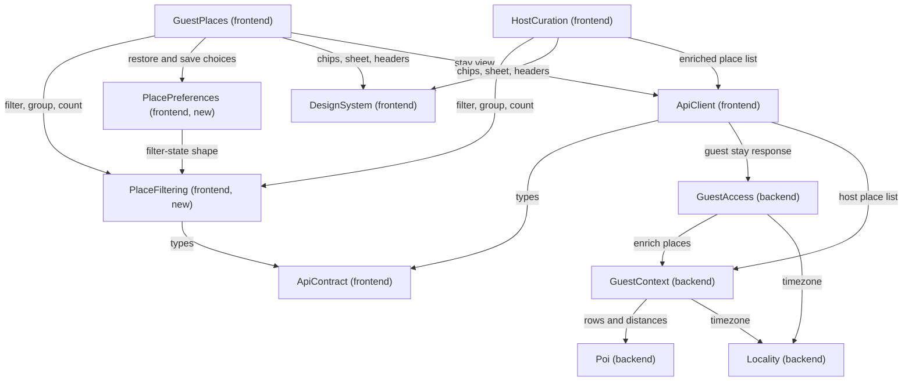

# Components: Places Filters and Collapsible Categories

Upstream:
- The requirements (`../requirements-analysis/requirements.md`, FR1–FR11 and NFR1–NFR8).
- The existing architecture and component-inventory documents for both repos under `aidlc/spaces/default/codekb/guestguideiq-app/` and `aidlc/spaces/default/codekb/guestguideiq-frontend/`.
- The answers in `domain-design-questions.md`, cited as DQ1–DQ5.
- Team practices in `aidlc/spaces/default/memory/team.md` (one API client module, imports flow downward, no storage or fetch in screen code). There is no separate team-practices document for this work.

This catalogue lists only the building blocks this work adds or changes. Every other component in the two inventories is untouched. Names follow the existing inventories where a component already exists. Two components are new: `PlaceFiltering` and `PlacePreferences`.

```yaml
components:
  - name: Poi
    summary: Backend place catalogue and distance calculation (existing, changed)
    behaviour: >
      Owns the place records and the straight-line distance calculation. Gains one
      new capability: given a property and a set of place ids, return each place's
      distance from the property in metres, or no value when the place or the
      property has no location. Uses the existing tested distance helpers. Never
      returns 0 for an unknown distance. Place coordinates stay inside this
      component and are not sent to any client.
    responsibilities:
      - Place records, including their coordinates
      - Distance from a property to each of a set of places
    depends_on: []
    dependents:
      - component: GuestContext
        interaction: Asks for base place rows and for distances from a property
    external_dependencies:
      - name: PostgreSQL
        kind: database
        purpose: Stores places; no geospatial extension, so distance is computed in code
    entities:
      - name: Place
        identifier: id
        attributes: [name, description, category, categoryId, address, latitude, longitude]

  - name: Locality
    summary: Backend locality brand and timezone resolution (existing, changed)
    behaviour: >
      Owns the locality record. Gains one capability: resolve the timezone that
      applies to a property, in the existing order (the locality's zone, then the
      property's own zone, then UTC), and report whether the result is a real
      configured zone or the fallback. Today this resolution happens privately
      inside guest access for stay expiry; it moves here so that both the guest
      response and the host's place list use the same answer.
    responsibilities:
      - Locality records
      - The timezone that applies to a property, and whether it is a fallback
    depends_on: []
    dependents:
      - component: GuestAccess
        interaction: Resolves the property's timezone for the guest response and for stay expiry
      - component: GuestContext
        interaction: Resolves the property's timezone for the host's place list
    external_dependencies:
      - name: PostgreSQL
        kind: database
        purpose: Stores localities and their timezone
    entities:
      - name: LocalityRecord
        identifier: id
        attributes: [name, timezone]

  - name: GuestContext
    summary: Backend place enrichment for guests and curation data for hosts (existing, changed)
    behaviour: >
      Already turns each place into the guest's enriched view (stance, hours,
      price, category). Gains two things. First, it adds each place's distance
      from the property to the guest view, obtained from Poi; unknown stays
      null. Second, it produces the host's enriched place list: each catalogue
      row with its shared category, opening hours, price level, distance, stance
      and whether the host added it, plus the property's timezone from Locality.
      Hidden and offered stances are included for the host and never for the
      guest. Price level 0 means free. Every new field is optional and nullable.
    responsibilities:
      - The guest's enriched place view, now including distance
      - The host's enriched place list, replacing the client-side join of stance
      - Per-property curation records (stance, note, rank)
      - Opening hours, price profile and shared category of a place
    depends_on:
      - component: Poi
        interaction: Base place rows and distances from the property
        style: sync
      - component: Locality
        interaction: The property's timezone for the host's place list
        style: sync
    dependents:
      - component: GuestAccess
        interaction: Enriches the guest's guide when a stay link is opened
      - component: ApiClient
        interaction: Reads the host's enriched place list
    external_dependencies:
      - name: PostgreSQL
        kind: database
        purpose: Stores listings, hours, price profiles and categories
    entities:
      - name: PropertyListing
        identifier: propertyId + placeId
        attributes: [stance, hostNote, rank, addedBy]
        references:
          - entity: Place
            owned_by: Poi
            relationship: each listing is one property's stance on one place
      - name: PlaceHours
        identifier: id
        attributes: [placeId, dayOfWeek, opens, closes, closesNextDay, isClosed, validFrom, validUntil]
        references:
          - entity: Place
            owned_by: Poi
            relationship: each hours rule belongs to one place
      - name: PlaceProfile
        identifier: placeId
        attributes: [priceLevel, setting, typicalMinutes, effort]
        references:
          - entity: Place
            owned_by: Poi
            relationship: each profile describes one place
      - name: PlaceCategory
        identifier: id
        attributes: [category, subcategory, slug, icon, sortOrder]

  - name: GuestAccess
    summary: Backend stay-link guard and the guest's one read (existing, changed)
    behaviour: >
      Authenticates a guest by stay link and returns the stay view. Gains one
      field on that response: the property's timezone, resolved by Locality, with
      a marker when it is only the fallback. No other change. The link token is
      still the only credential and is never echoed anywhere new.
    responsibilities:
      - Stay links and the guest stay response
      - Including the property's timezone in that response
    depends_on:
      - component: GuestContext
        interaction: Enriches the guide's places, now with distance
        style: sync
      - component: Locality
        interaction: Resolves the property's timezone
        style: sync
    dependents:
      - component: ApiClient
        interaction: Reads the guest stay response
    external_dependencies:
      - name: PostgreSQL
        kind: database
        purpose: Stores stays
    entities:
      - name: Stay
        identifier: id
        attributes: [propertyId, checkIn, checkOut, guestName]

  - name: ApiContract
    summary: Frontend hand-written types for the backend's responses (existing, changed)
    behaviour: >
      Declares the shapes the frontend receives. Gains: distance on a guest
      place, the timezone and its fallback marker on the guest stay view, and
      the enriched host place row (category, hours, price level, distance,
      stance) with the timezone on the host list. All new fields are optional
      and nullable. The provenance record is updated in the same change.
    responsibilities:
      - Wire types and path constants
      - The provenance record of where each type was transcribed from
    depends_on: []
    dependents:
      - component: ApiClient
        interaction: Types every request and response
      - component: PlaceFiltering
        interaction: Uses the place, hours and category types
    external_dependencies: []
    entities: []

  - name: ApiClient
    summary: Frontend's single module that calls the backend (existing, changed)
    behaviour: >
      The only place that makes a request. No new call is added: the guest stay
      read and the host place list read return richer data. The host panel stops
      joining stance from a second call, because the enriched list carries it.
      Still returns a result value and never throws.
    responsibilities:
      - Every request to the backend
      - Passing the richer guest stay view and host place list to the screens
    depends_on:
      - component: ApiContract
        interaction: Types for requests and responses
        style: sync
      - component: GuestAccess
        interaction: Reads the guest stay response over HTTP
        style: sync
      - component: GuestContext
        interaction: Reads the host's enriched place list over HTTP
        style: sync
    dependents:
      - component: GuestPlaces
        interaction: Supplies the guest's places, distance and timezone
      - component: HostCuration
        interaction: Supplies the host's enriched place list and timezone
    external_dependencies: []
    entities: []

  - name: PlaceFiltering
    summary: Frontend UI-free rules for grouping, filtering and sorting places (new)
    behaviour: >
      Pure logic with no screen code and no network or storage access. Groups
      places by shared category in one order for both screens, with "Other
      places" last and a flat list when no place has a category. Evaluates
      whether a place is open at an instant or at any time on a given date in a
      given timezone, handling several spans a day, spans that close after
      midnight, closed days and date-limited rules; malformed or missing hours
      count as unknown and never throw. Applies the category, open, price, host
      picks and distance filters combined with AND. Sorts by the host's order or
      nearest first, with unknown distances last. Reports per-category counts,
      the total, and how many places were left out because they had no value
      for an active filter. Decides which filters to hide when no place has the
      data. Formats distance in miles. Treats price level 0 as free.
    responsibilities:
      - One grouping and ordering of places for both screens
      - Open-now and open-on-a-day evaluation
      - Combining filters, sorting, and counting
      - Which filters are available for a given list
    depends_on:
      - component: ApiContract
        interaction: Place, hours and category types
        style: sync
    dependents:
      - component: GuestPlaces
        interaction: Filters, groups and counts the guest's places
      - component: HostCuration
        interaction: Filters, groups and counts the host's places
      - component: PlacePreferences
        interaction: Uses the filter-state shape and drops choices that no longer apply
    external_dependencies: []
    entities: []

  - name: PlacePreferences
    summary: Frontend store for a guest's remembered filter choices (new)
    behaviour: >
      The one module allowed to read and write the browser's storage for filter
      choices. Stores a guest's filters, sort and expanded categories under a key
      built from the property and the stay's dates, never from the stay link
      token. Reads never throw: unreadable, blocked or malformed storage yields
      no remembered choices. Choices that no longer apply are dropped and the
      rest kept. Clearing filters clears the stored entry. Holds no credential
      and no personal data.
    responsibilities:
      - Reading, writing and clearing remembered choices for a stay
      - Building the storage key without using the link token
    depends_on:
      - component: PlaceFiltering
        interaction: The filter-state shape and the rule for dropping stale choices
        style: sync
    dependents:
      - component: GuestPlaces
        interaction: Restores and saves the guest's choices
    external_dependencies:
      - name: Browser local storage
        kind: other
        purpose: Keeps remembered choices on the device
    entities:
      - name: StoredPlacePreference
        identifier: storageKey
        attributes: [filters, sort, expandedCategories, savedAt]

  - name: DesignSystem
    summary: Frontend shared controls (existing, changed)
    behaviour: >
      Gains the generic controls both screens need: a filter chip with a pressed
      state, a horizontally scrolling chip row, a collapsible section header that
      exposes its open or closed state and a count, a filter sheet built as a
      modal dialog that keeps focus inside and makes the page behind it inert,
      a checkbox group and a radio group. Controls know nothing about places.
      Touch targets are at least 44 by 44 CSS pixels.
    responsibilities:
      - Generic, accessible controls with no knowledge of places
    depends_on: []
    dependents:
      - component: GuestPlaces
        interaction: Renders chips, the sheet and collapsible headers
      - component: HostCuration
        interaction: Renders chips, the sheet and collapsible headers
    external_dependencies: []
    entities: []

  - name: GuestPlaces
    summary: Frontend guest Places tab within the guide view (existing, changed)
    behaviour: >
      The Places tab of the shared guide renderer. Holds the guest's current
      filter state, follows the selected day from the day rail for the open
      filter, shows collapsible category sections with counts, the chip row, the
      filter sheet, the result line and the "Host pick" label on featured
      places. Restores and saves choices through PlacePreferences. Works with no
      places, no property and no stay, as in the owner's preview, by showing the
      existing empty state with no filter controls. Adds no second tab set.
    responsibilities:
      - The guest's filter state and its presentation
      - Collapsible category sections on the Places tab
    depends_on:
      - component: PlaceFiltering
        interaction: Filters, groups, sorts and counts places
        style: sync
      - component: PlacePreferences
        interaction: Restores and saves remembered choices
        style: sync
      - component: DesignSystem
        interaction: Chips, filter sheet, collapsible headers
        style: sync
      - component: ApiClient
        interaction: Receives the stay view with places, distance and timezone
        style: sync
    dependents: []
    external_dependencies: []
    entities: []

  - name: HostCuration
    summary: Frontend host Local recommendations panel (existing, changed)
    behaviour: >
      The host's panel for picking and curating places. Gains the same filters,
      result line and collapsible categories as the guest tab, using the same
      grouping, so the two screens agree on category names and order. Its open
      filter always means open now. Filters and collapsing change only what the
      host sees; picking, featuring, listing, hiding, adding and editing still
      work on every visible row. Does not remember choices across visits.
      Reads stance from the enriched place list instead of joining a second call.
    responsibilities:
      - The host's filter state and its presentation
      - Collapsible category sections in the host panel
    depends_on:
      - component: PlaceFiltering
        interaction: Filters, groups, sorts and counts places
        style: sync
      - component: DesignSystem
        interaction: Chips, filter sheet, collapsible headers
        style: sync
      - component: ApiClient
        interaction: Receives the enriched place list and timezone
        style: sync
    dependents: []
    external_dependencies: []
    entities: []
```

## Component Diagram



<!-- Text fallback: On the frontend, GuestPlaces and HostCuration both use PlaceFiltering for the rules, DesignSystem for the controls and ApiClient for data. Only GuestPlaces uses PlacePreferences, which depends on PlaceFiltering for the filter-state shape. PlaceFiltering and ApiClient depend on ApiContract for types. ApiClient calls two backend components over HTTP: GuestAccess for the guest stay response and GuestContext for the host place list. On the backend, GuestAccess depends on GuestContext and Locality, and GuestContext depends on Poi and Locality. Poi, Locality, ApiContract and DesignSystem depend on nothing in this catalogue. The graph has no cycle. -->

## Component Summary

| Component | Purpose | Depends On | Dependents | Entities Owned |
|---|---|---|---|---|
| Poi | Place records and distance from a property | none | GuestContext | Place |
| Locality | Locality records and the timezone for a property | none | GuestAccess, GuestContext | LocalityRecord |
| GuestContext | Guest place enrichment and the host's enriched place list | Poi, Locality | GuestAccess, ApiClient | PropertyListing, PlaceHours, PlaceProfile, PlaceCategory |
| GuestAccess | Stay links and the guest stay response | GuestContext, Locality | ApiClient | Stay |
| ApiContract | Frontend wire types | none | ApiClient, PlaceFiltering | none |
| ApiClient | The one frontend module that calls the backend | ApiContract, GuestAccess, GuestContext | GuestPlaces, HostCuration | none |
| PlaceFiltering | UI-free grouping, filtering, sorting and counting | ApiContract | GuestPlaces, HostCuration, PlacePreferences | none |
| PlacePreferences | Remembered filter choices for a stay | PlaceFiltering | GuestPlaces | StoredPlacePreference |
| DesignSystem | Generic accessible controls | none | GuestPlaces, HostCuration | none |
| GuestPlaces | Guest Places tab | PlaceFiltering, PlacePreferences, DesignSystem, ApiClient | none | none |
| HostCuration | Host Local recommendations panel | PlaceFiltering, DesignSystem, ApiClient | none | none |

## Entity Ownership

| Entity | Owning Component | Identifier | Attributes | References |
|---|---|---|---|---|
| Place | Poi | id | name, description, category, categoryId, address, latitude, longitude | none |
| LocalityRecord | Locality | id | name, timezone | none |
| PropertyListing | GuestContext | propertyId + placeId | stance, hostNote, rank, addedBy | Place (Poi) |
| PlaceHours | GuestContext | id | placeId, dayOfWeek, opens, closes, closesNextDay, isClosed, validFrom, validUntil | Place (Poi) |
| PlaceProfile | GuestContext | placeId | priceLevel, setting, typicalMinutes, effort | Place (Poi) |
| PlaceCategory | GuestContext | id | category, subcategory, slug, icon, sortOrder | none |
| Stay | GuestAccess | id | propertyId, checkIn, checkOut, guestName | none |
| StoredPlacePreference | PlacePreferences | storageKey | filters, sort, expandedCategories, savedAt | none |

No new database entity is introduced. The backend entities above already exist; they are listed because this work reads them in new ways. `StoredPlacePreference` is the only new stored thing, and it lives in the guest's browser.

## External Dependencies

| Component | Dependency | Kind | Purpose |
|---|---|---|---|
| Poi | PostgreSQL | database | Places; distance is computed in code because there is no geospatial extension |
| Locality | PostgreSQL | database | Localities and their timezone |
| GuestContext | PostgreSQL | database | Listings, hours, price profiles, categories |
| GuestAccess | PostgreSQL | database | Stays |
| PlacePreferences | Browser local storage | other | Remembered choices on the guest's device |

No third-party service is added. The Google Maps view is out of this work.

## Rationale

| Component | Why it is a separate building block |
|---|---|
| Poi | Owns place data and coordinates. Keeping distance here means coordinates never leave the component (DQ1) |
| Locality | The timezone rule is needed by two components. Putting it in either would make the other depend on it in the wrong direction (ADR-003) |
| GuestContext | Already the place that joins stance, hours, price and category. The host's enriched list is the same join for a different audience (DQ3, ADR-004) |
| GuestAccess | Owns the guest's one read. It changes only by carrying the timezone |
| ApiContract | The frontend's type boundary, with its own provenance record that must change with the backend |
| ApiClient | Team practice: exactly one module calls the backend |
| PlaceFiltering | Distinct concern and change rate: rules with no screen code, shared by two screens so they cannot drift apart (DQ4, ADR-005) |
| PlacePreferences | Distinct data ownership and a security boundary: the only module that touches storage for this feature (DQ5, ADR-006) |
| DesignSystem | Generic controls reused by both screens; no knowledge of places |
| GuestPlaces | The guest screen: owns the guest's filter state and the day-rail rule |
| HostCuration | The host screen: owns the host's filter state and keeps curation actions |

### Component-boundary options considered

**Where the filtering rules live (DQ4)**
- Option A — one shared UI-free module (`PlaceFiltering`): both screens agree by construction and the rules are unit-testable. Cost: the host panel's existing grouping module is replaced. Easy to reverse.
- Option B — each screen keeps its own logic: no refactor of the host panel, but two implementations of hours evaluation and grouping to keep in step.
- Chosen: A (DQ4). Alternatives rejected: B, because requirement FR9.3 needs the two screens to match and they already differ today.

**Where the timezone rule lives**
- Option A — in `Locality`, used by `GuestAccess` and `GuestContext`.
- Option B — leave it in `GuestAccess` and have `GuestContext` call it: creates a cycle, since `GuestAccess` already depends on `GuestContext`.
- Option C — duplicate the rule in `GuestContext`: two copies of a rule that must agree.
- Chosen: A. See ADR-003.

## Platform and design notes

- **Platform:** nothing in this design needs new infrastructure. There is no new service, database table, environment variable, secret or network origin. The security headers and referrer policy stay as they are (NFR4). The backend change is additive (NFR6), so the backend can deploy before the frontend. The distance calculation adds in-memory arithmetic to two existing reads and no new database query pattern beyond reading coordinates for a property's places.
- **Design:** the new controls belong in `DesignSystem` as generic parts with no knowledge of places, so both screens share one accessible implementation (NFR1). The List / Map toggle from the wireframes is not built, because the map is out of this work. The existing Places tabs stay the only tab set on the page.

## Open points carried to functional design

- The locality timezone defaults to UTC in the database, so "configured" and "never set" look the same. The fallback marker (ADR-003) needs a rule for this case, or "open now" will be wrong for unset localities without anyone noticing.
- Review findings accepted at the requirements gate still need answers at functional design: "open now" outside the stay window (R-03), the older free flag versus price level 0 (R-04), whether hidden places count on the host panel (R-07).
- Whether the host's enriched list is served at the existing place-list address by composing `Poi` and `GuestContext` at the HTTP edge (ADR-004).


## Review

**Verdict:** READY
**Reviewer:** aidlc-architecture-reviewer-agent
**Date:** 2026-10-01T16:37:39Z
**Iteration:** 1

### Findings

| ID | Severity | Location | Finding | Required action | Status |
|---|---|---|---|---|---|
| R-01 | Major | aidlc/spaces/default/intents/260927-places-filters/inception/domain-design/components.md > components Poi (`depends_on: []`), GuestContext, GuestAccess; Component Diagram text fallback "The graph has no cycle"; decisions.md > ADR-004 | The acyclic claim holds only because the HTTP route layer is left out of the graph. In the backend, `src/poi/routes.ts` already imports `HostContentService` from `guestcontext/hostContent`, which itself imports `POIRepository`, so Poi and GuestContext are already mutually dependent through the `/v1/pois` route. ADR-004 says the enriched list is "composed at the HTTP edge" at the existing address but never names which component owns that route (today it is Poi's). `src/guestcontext/routes.ts` also imports `StayRepository` from `guestaccess`, so GuestAccess and GuestContext are mutually dependent too. That weakens the stated reason for rejecting ADR-003 Option B ("would create a cycle"). | Name the owner of the composing route. Either declare a bounded, disclosed route-level dependency (Poi routes to GuestContext) and state that it does not extend below the route layer, or move the host place-list route under GuestContext. Correct "graph has no cycle" and the ADR-003 rationale so they match the code. | New |
| R-02 | Major | components.md > component Locality and Rationale "Where the timezone rule lives"; decisions.md > ADR-003 | "Timezone resolution moves into Locality" is heavier than the code needs and is not fully accurate. The rule is a two-value coalesce (`localityBrand?.timezone ?? property.timezone ?? 'UTC'`) written inline in the Prisma mapper at `guestaccess/repository.ts:130`. `endOfDayInZone` lives in `lib/dayBoundary.ts`, not in guest access. A third copy exists in `event/repository.ts:287` (`locality?.timezone ?? 'UTC'`, with no property zone), so "one rule, never disagree" is not delivered. Moving it to Locality also gives Locality a read of the property's own zone, but the catalogue has no Property component or entity, so Locality's `depends_on: []` and the "aware of a property attribute" consequence hide an undeclared dependency. No lighter option (a pure helper beside `dayBoundary`) was considered. | Add the pure-helper alternative to the options and ADR-003. State where the property's zone is read from. Say whether event expiry adopts the same rule, and if not, why the two may differ. | New |
| R-03 | Minor | components.md > component PlacePreferences; decisions.md > ADR-006; requirements.md > NFR4 | NFR4 says browser storage is reached "only through the frontend's existing storage boundary". ADR-006 deliberately adds a new storage module with its own lint allowance. The ADR records the departure and its cost, but the requirement text still says otherwise and nothing flags the conflict for the gate. | Surface the conflict at the approval gate and amend the NFR4 wording, or note it as an accepted deviation. | New |
| R-04 | Minor | components.md > Open points carried to functional design (timezone fallback); components Locality, GuestAccess | The fallback marker is left undefined, but its shape ships in the additive guest and host response contracts, which are hard to change after the backend deploys first (NFR6). The locality timezone column is non-null and defaults to `UTC` (`schema.prisma:1505`), so for any locality the "property zone" branch never fires and "configured" cannot be told from "never set". Without a rule, FR4 and FR8.1 cannot decide when to hide the open filter. | Before units generation, record at least the intended semantics (for example "fallback means no locality brand, or the locality zone is the unset default") so the API field can be specified. | New |
| R-05 | Minor | decisions.md > ADR-001 Consequences ("one property's picks"); components.md > component Poi | The distance cost claim is wrong for the host list. `GET /v1/pois` returns the whole locality catalogue (frontend api-documentation `listPois`), not one property's picks, and the host list is unpaginated (ADR-004). Distance is computed for the whole catalogue on every host read, and each call needs the place coordinates (not carried in the current host rows) plus the property coordinates lookup. Likely still cheap, but it is not the cost the ADR states, and NFR3 is sized at 200 places. | Correct the ADR-001 statement and size it against the catalogue. State the `Poi` method's inputs (property id, place ids) and which repository call supplies place coordinates. | New |
| R-06 | Minor | domain-design/traceability.json > FR1.3, FR10.1, FR10.2, FR10.6, NFR6, NFR7; components.md > component ApiContract | Several mappings name only part of the realising set. FR1.1 to FR1.4 map to one screen or the design system, while FR9.1 requires HostCuration to apply the same collapsing and first-expanded rule. FR10.1 and FR10.2 map to Poi and Locality only, while GuestAccess and GuestContext carry the fields. NFR6 maps to GuestContext only. NFR7's "hours evaluation never throws" belongs to PlaceFiltering. FR10.6 also requires the frontend mock handlers (`src/mocks`) to change, and no component owns them. | Add the missing secondary targets (rows may be multi-target) and name the owner of the mock handlers, for example under ApiContract or ApiClient. | New |
| R-07 | Minor | components.md > component PlacePreferences; decisions.md > ADR-006 | The storage key depends on the property id and stay dates, but `GuestStayView.stay` is optional (owner preview, older payloads). The design does not say what happens when it is absent. Entry expiry is also left to functional design, so stored entries grow without bound until then. | State that without a stay no choices are persisted and no key is built. Record the expiry rule (for example after check-out) as a functional-design item. | New |

### Validation Tool Results

| Tool | Result | Interpretation |
|---|---|---|
| Manual YAML checks | PASS | Names unique; every referenced component declared; no self-dependency; `depends_on` and `dependents` symmetric for all 11 components; every entity has one owner and an identifier; every `references.entity` (Place) is declared under its `owned_by` (Poi). Graph is acyclic at the catalogue level only (see R-01). |
| Diagram and tables vs YAML | PASS | The edges, summary table, entity table and external dependencies all match the YAML. |
| Code spot-checks | PARTIAL | Confirmed: `haversineMeters` in `poi/geo.ts` and a property-coordinates port exist; `LocalityEntity.timezone` defaults to UTC; `PropertyIdentity` carries `id`, so the key inputs exist when `stay` is present. Contradicted or missing: see R-01, R-02, R-05, R-07. |
| traceability.json | PASS with notes | Every FR and NFR in the requirements is present. Mappings are reasonable but incomplete in places (R-06). |

### Summary

The decomposition is implementable and DQ1 to DQ5 are reflected faithfully, with sound ADRs and a clean catalogue graph. The two items to weigh before approving are that the "acyclic" claim ignores existing route-level cycles between Poi, GuestContext and GuestAccess (R-01), and that moving timezone resolution into Locality is heavier than the code needs and leaves a third copy and an undeclared property dependency (R-02). Neither blocks units generation.
