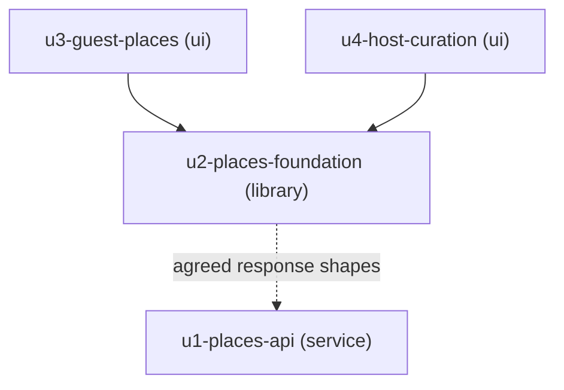

# Unit Dependency Topology: Places Filters and Collapsible Categories

Topology only. This document says which unit may depend on which, and which units could be worked on at the same time. It does not choose a build order. It builds on the component catalogue (`../domain-design/components.md`), the decisions (`../domain-design/decisions.md`) and the requirements (`../requirements-analysis/requirements.md`), and uses the units defined in `unit-of-work.md`.

## Edge block

```yaml
units:
  - name: u1-places-api
    kind: service
    depends_on: []
  - name: u2-places-foundation
    kind: library
    depends_on: []
  - name: u3-guest-places
    kind: ui
    depends_on: [u2-places-foundation]
  - name: u4-host-curation
    kind: ui
    depends_on: [u2-places-foundation]
```

## Dependency graph



<!-- Text fallback: u3-guest-places and u4-host-curation each depend on u2-places-foundation. u1-places-api and u2-places-foundation depend on no other unit. A dotted line from u2 to u1 marks an agreement on response shapes, not a build dependency. There is no cycle. -->

## Edges

| Unit | Depends on | Why |
|---|---|---|
| u1-places-api | none | Backend changes stand alone and are backwards compatible |
| u2-places-foundation | none | Built against the agreed response shapes and its own mocks, not the finished backend (answer UQ2) |
| u3-guest-places | u2-places-foundation | Uses the filtering rules, remembered choices, shared controls and the new types |
| u4-host-curation | u2-places-foundation | Uses the filtering rules, shared controls and the new types |

No edge exists between `u3-guest-places` and `u4-host-curation`. Neither screen imports the other.

## Integration points

| Between | What crosses | Form |
|---|---|---|
| u1-places-api and u2-places-foundation | The guest stay response and the host place list, with the new optional fields (distance, timezone and its fallback marker, and the host row's category, hours, price and stance) | HTTP responses. The shapes are hand-kept on both sides and must be agreed at functional design. There is no generated contract |
| u2-places-foundation and u3-guest-places | Filtering rules, remembered choices, shared controls, types | Module imports inside the frontend |
| u2-places-foundation and u4-host-curation | Filtering rules, shared controls, types | Module imports inside the frontend |

The agreement between u1 and u2 is the one place where the two repos can drift without a test failing, because the frontend tests run against mocks. The team's compensating control is the thin live-backend check, which can only run once both u1 and the frontend units exist.

## Parallel development opportunities

- `u1-places-api` and `u2-places-foundation` have no dependency between them and can be worked on at the same time.
- `u3-guest-places` and `u4-host-curation` have no dependency between them and can be worked on at the same time, once `u2-places-foundation` exists.
- Valid orderings include any that place `u2-places-foundation` before both screens. `u1-places-api` can fall anywhere.

## Deployment relationship

- `u1-places-api` deploys with the backend service. The other three deploy together in the frontend bundle.
- The backend additions are optional fields, so either repo can deploy first without breaking the other. Until both are deployed, the new filters that need backend data stay hidden.
